# ES_PHYS_P011 – Integrated borehole and surface seismic well tie in Python

A Python implementation, in progress, of

> Lewis, O. J., Smith, P., Hohner, M., Kvist-Lassen, T., Dahlhaus, L., Stuberg, L., Granli, J. R.,
> Veire, H., & Berger, P. (2016). *Integrated processing of borehole and surface seismic
> measurements for enhanced well tie and AVO analysis.* 78th EAGE Conference & Exhibition, Vienna,
> paper Th SRS3 04. https://doi.org/10.3997/2214-4609.201601553 (PDF in [`References/`](References/))

and of the methods of its three references:

- WA-VSP anisotropy (Leaney & Hornby, 2007);
- sonic-derived γ (Walsh et al., 2007);
- ray-based Q-compensated depth imaging (Cavalca et al., 2013).

The roadmap, assumptions, critical assessment and full reference list are in
[`docs/IMPLEMENTATION_PLAN.md`](docs/IMPLEMENTATION_PLAN.md).

**Status:** work packages 1 (foundations), 2 (forward modelling), 3 (ZO-VSP processing, Q and
the sonic calibration), 4 (sonic anisotropy), 5 (walkaway anisotropy and the γ → (ε, δ)
calibration), 6 (ray tracing and Q-compensated depth imaging, the Fig. 3 experiment), 7 (the
integrated loop with its discrepancy register, multiples, the Fig. 2, 4 and 5 analogues) and 8
(SEG-Y and LAS adapters, the `iwt` command, the critical assessment) are implemented. What the
work found about the article is summarized in
[The article's claims, tested on the synthetic well](#the-articles-claims-tested-on-the-synthetic-well).

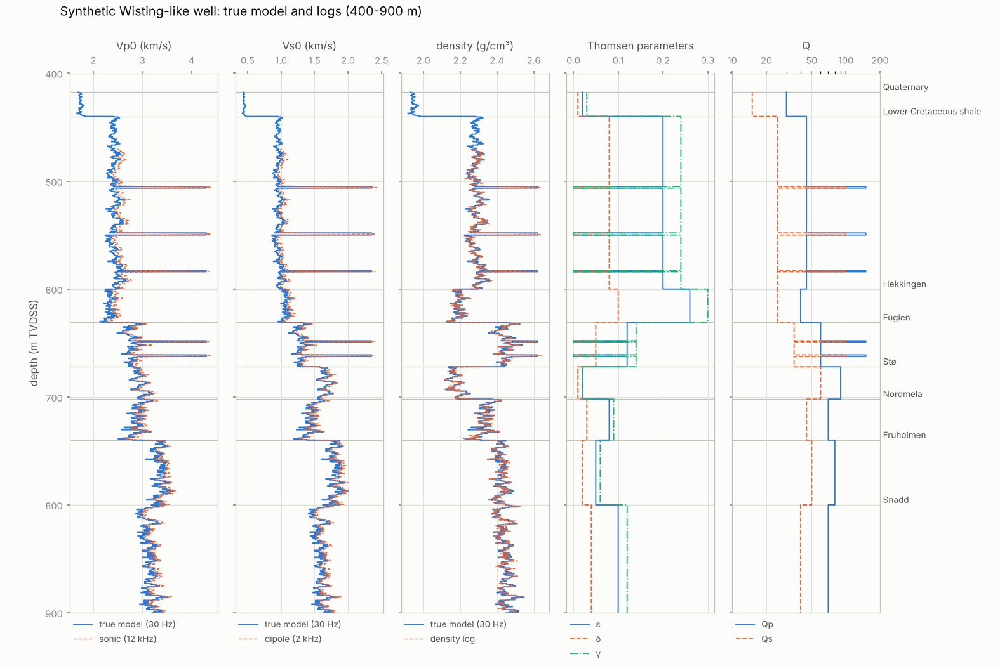

## The method in one paragraph

Wisting (OMV, southwest Barents Sea) is an oil reservoir only about 250 m below the seabed. Its
first two wells would not tie to the surface seismic. At the third well, Hanssen (7324/7-2), OMV
acquired wireline sonic, a zero-offset VSP and a multi-azimuth walkaway VSP. All data were then
processed *together*:

1. **Build one model:** a single 1D elastic model with VTI anisotropy and Q, sampled every
   0.5 m, from surface to TD.
2. **Predict:** model the borehole and surface seismic responses from it.
3. **Explain each mismatch:** remove it by editing, reprocessing or updating the model.
4. **Repeat** until all data sets agree.

The tie needed two things in depth imaging: anisotropy and Q in the overburden, and a
rock-physics Vs in the reservoir. The work also showed that interbed multiples contaminate the
reservoir AVO, and the reprocessed image revealed an oil–water contact.

## Installation

```bash
pip install -e .            # core: numpy and scipy; installs the `iwt` command
pip install -e ".[all]"     # + matplotlib (figures) and lasio (LAS files)
pip install -e ".[dev]"     # + pytest, pyflakes and segyio (cross-check of the SEG-Y reader)
```

Python ≥ 3.9. CI (GitHub Actions) runs pyflakes and the tests on Python 3.9 and 3.13. SEG-Y
needs no extra package.

## Quick start

```python
import numpy as np
import iwt

model, logs = iwt.wisting_like_well()      # true 1D VTI + Q model and wireline logs
model.validate()                           # positive-definite stiffness, delta bound, Q > 0
model.twt(672.0)                           # two-way vertical time to top Stø (s)
model.at(650.0)                            # properties at a depth

c = model.cij()                            # C11, C13, C33, C44, C66 per layer (Pa)
blocked = model.block([600.0, 631.0, 672.0])         # Backus (1962) blocking
seismic_scale = model.backus(10.0, respect=[417.5])   # running Backus average, 10 m window
vp, vsv, vsh = iwt.phase_velocities(np.radians(30.0), 2400.0, 950.0, 0.20, 0.08, 0.24)  # exact VTI

logs.las_curves()                          # DEPT (m RKB), TVDSS, DTCO, DTSM (us/ft), RHOB (g/cm3)

# forward modelling (WP2)
from iwt.modeling import reflection
from iwt.modeling.convolution import ricker, angle_gather, normal_incidence
from iwt.modeling.reflectivity import Reflectivity

theta = np.radians([0.0, 20.0, 40.0])
upper, lower = (2815.0, 1306.0, 2454.0, 0.138, 0.038), (2911.0, 1656.0, 2164.0, 0.023, 0.009)
reflection.exact_pp(theta, upper, lower)   # exact VTI PP coefficient (also: zoeppritz_pp, ruger, ...)

wav = ricker(30.0, 0.002)
t, ang, gather = angle_gather(model, [0, 10, 20, 30], 0.002, 600, wav, method="exact_vti")
refl = Reflectivity(model.subset(0.0, 1000.0), attenuation=True, free_surface=False)
rec = refl.record([100.0, 500.0], 6.0, [8.0], 0.002, 600, wav, "pressure", f_max=90.0, workers=4)
rec.data                                   # [receiver, offset, time]

# ZO-VSP processing, Q and the sonic calibration (WP3)
from iwt import calibration
from iwt.vsp import zovsp, attenuation

depths = np.arange(450.0, 1650.1, 10.0)
vsp = zovsp.synthetic_zovsp(model, depths, 6.0, 0.001, 1600, ricker(40.0, 0.001), f_max=150.0)
pk = zovsp.pick_first_breaks(vsp.t, vsp.data)                   # tracked first-arrival peaks
down, up = zovsp.separate_wavefields(vsp.t, vsp.data, pk)       # parametric up/down separation
t30 = zovsp.phase_delay_times(vsp.t, down, 30.0, pk)            # traveltimes at 30 Hz
f, S = attenuation.first_arrival_spectra(vsp.t, down, pk)
dts = attenuation.centroid_shift(f, S, (10.0, 100.0))           # t* relative to 450 m
q = attenuation.interval_q(depths, t30, dts, boundaries=[600.0, 740.0, 800.0])
drift = calibration.drift(logs.depth, logs.vp, depths, t30)     # VSP minus integrated sonic

# Thomsen gamma from the sonic logs (WP4)
from iwt import sonic
from iwt.synthetic import caliper_log, stoneley_log

radius, caliper = caliper_log(model, logs.depth)                # washouts in the shales
st = stoneley_log(model, logs.depth, sonic.Mud(1540.0, 1250.0), radius)   # 500 Hz, 46 mm tool
tool = sonic.Borehole(radius=0.108, tool_radius=0.046)
res = sonic.sonic_anisotropy(logs.vp, logs.vs, logs.rho, st.slowness, sonic.Mud(1500.0, 1250.0),
                             tool, frequency=500.0, radius=caliper)   # exact TI Stoneley mode
res.gamma                                                       # (C66 - C44) / (2 C44)

# eps and delta from a walkaway VSP, and the gamma -> (eps, delta) calibration (WP5)
from iwt.vsp import walkaway
from iwt.calibration import bayes_linear

seis = model.backus(40.0, respect=[417.5])                      # the medium a 40 m sub-array sees
offsets = np.concatenate([-np.arange(2500.0, 199.0, -25.0), np.arange(200.0, 2501.0, 25.0)])
survey = walkaway.synthetic_walkaway(seis, offsets, np.arange(600.0, 901.0, 10.0),
                                     time_noise=0.2e-3, psi_noise=np.radians(1.5))   # exact qP rays
data = walkaway.measure_slowness(survey, 770.0, time_noise=0.2e-3, psi_noise=np.radians(1.5))
data = data.select((data.theta > np.radians(30.0)) & (data.theta < np.radians(60.0)))
post = walkaway.invert_level(data, prior={"vp0": (3370.0, 34.0), "vs0": (1805.0, 90.0)})
post["eps"], post["delta"], post.data_weight                     # (mean, std); share from the data
cal = bayes_linear([0.20, 0.05, 0.10, 0.07, 0.12, 0.12],         # gamma at the levels
                   [0.13, 0.05, 0.08, 0.05, 0.10, 0.10], 0.006)  # walkaway eps and its errors
cal.predict(0.3)                                                 # eps (mean, std) where gamma = 0.3

# ray tracing and Q-compensated depth migration of a CMP gather (WP6)
from iwt import avo, imaging
from iwt.raytrace import reflection_table

mig = model.backus(20.0, respect=[417.5])                       # migration model (VTI, with Q)
x = np.arange(100.0, 851.0, 50.0)
tab = reflection_table(mig, np.arange(640.0, 700.0, 0.5), x, 6.0, 8.0)  # time, angle, t*, spreading
gather = np.zeros((x.size, 1000))                                # data[offset, time], dt = 1 ms
image = imaging.migrate_cmp(gather, 0.001, x, mig, tab.depth, 6.0, 8.0, table=tab,
                            q_compensation="amplitude", gain_limit=10.0, high_cut=80.0)
fit = avo.intercept_gradient(tab.theta[0], np.ones(x.size), (20.0, 44.0))   # A + B sin^2(theta)

# the integrated loop: model versions, discrepancy register, tie metrics, multiples (WP7)
from iwt import multiples, welltie, workflow
from iwt.synthetic import SEA_WATER

reg = workflow.Register()
v0 = reg.new_version("logs", workflow.model_from_logs(logs, 417.5, SEA_WATER.vp0, SEA_WATER.rho),
                     "sonic, dipole and density as logged")
v1 = reg.new_version("ZO-VSP calibrated",                        # sonic moved to 30 Hz, gap from VSP
                     workflow.model_from_logs(logs, 417.5, SEA_WATER.vp0, SEA_WATER.rho, qp=60.0,
                                              qs=30.0, gap_vp=2130.0), "Q, dispersion, gap")
reg.log("synthetic late against the corridor stack", "blind gap above the logs",
        "fill the gap from the VSP", "shift 1 ms", "adopt", version=v1.number)
reg.check("corridor stack vs synthetic, correlation", 0.93, 0.8, ">=")
print(reg.to_markdown())                    # versions, discrepancies, criteria
syn = normal_incidence(v1.model, 0.002, 600, wav)[1]
m = welltie.tie_metrics(np.roll(syn, 2), syn, 0.002)            # correlation, shift, phase, scale, PEP
g = multiples.gathers(v1.model.subset(0.0, 780.0), [300.0], 6.0, 8.0, 0.002, 600, wav, f_max=90.0)
g.keys()                                    # full, primaries, no mode conversion, ..., Born primaries

# files and the ZO-VSP chain in one call (WP8)
from iwt import io
from iwt.vsp.processing import process_zovsp

io.write_zovsp("zovsp.sgy", vsp)                                # SEG-Y; also read_segy, read_gather
res = process_zovsp(io.read_zovsp("zovsp.sgy"), 1470.0, q_blocks=[600.0, 740.0, 800.0])
res.times, res.q.q                                              # vertical times, apparent Q per block
```

## Command line

`pip install -e .` installs the `iwt` command (`python -m iwt` is the same). The demo writes the
synthetic well as files, and the next three commands run the ZO-VSP, model and tie steps on them,
as they would on recorded data:

```bash
iwt demo demo/            # logs (LAS and CSV), ZO-VSP and a seismic trace at the well (SEG-Y)
iwt vsp demo/zovsp.sgy --datum-velocity 1470 --q-blocks 600 740 800 \
        --logs demo/logs.las --water-depth 417.5 --corridor demo/corridor.sgy -o demo/vsp.json
iwt model demo/logs.las --water-depth 417.5 --vsp demo/vsp.json -o demo/model.csv
iwt tie demo/model.csv demo/corridor.sgy --plot demo/tie.png
iwt tie demo/model.csv demo/seismic.sgy --attenuation
```

```text
121 levels 450.0-1650.0 m; one-way time 0.3004-0.6867 s; first-arrival peak 47 Hz
intrinsic Q per block: 450-600 m: 45; 600-740 m: 59; 740-800 m: 120; 800-1650 m: 72
2402 layers to 1670.0 m; logs 470.0-1670.0 m
  intrinsic Q from demo/vsp.json
  gap velocity 2129 m/s from the VSP
  model vertical time minus VSP: mean -0.77 ms, RMS 0.83 ms
window 0.638-1.382 s, ricker wavelet: correlation 0.944 (best 0.980), shift +0.7 ms, phase +3 deg, ...
window 0.638-1.298 s, ricker wavelet: correlation 0.950 (best 0.990), shift +1.5 ms, phase -4 deg, ...
```

- **`iwt vsp`** runs the WP3 chain on a zero-offset VSP: picks, separation, 30 Hz traveltimes,
  interval velocities, t\* and interval Q. With `--logs` it subtracts the stratigraphic t\*
  (intrinsic Q). It writes the corridor stack and a time-depth CSV if asked.
- **`iwt model`** builds the 0.5 m elastic model from the logs. It moves the sonic velocities to
  30 Hz with the VSP Q (Qs = Qp/2), fills the gap above the logs with the VSP velocity, and adds
  optional ε, δ and γ curves. It reports the model's misfit to the VSP times.
- **`iwt tie`** makes the normal-incidence synthetic, with a Ricker or a least-squares wavelet,
  and reports the tie metrics.

`iwt <command> --help` lists every option.

## What WP1 provides

| Plan item | Code | Notes |
|---|---|---|
| numbers in the article, with provenance | `iwt.paper` | Table 1, angles, exclusion zone, the six WA-VSP levels, the Fig. 3 ranking; public well facts kept separate with their sources |
| 1D elastic VTI model with Q | `iwt.model.ElasticModel1D` | layers between interfaces; Thomsen parameters at reference frequency `f_ref` |
| Thomsen ↔ Cij (exact) | `thomsen_to_cij`, `cij_to_thomsen`, `delta_min` | Thomsen (1986); δ lower bound for real C13 |
| stability checks | `is_stable`, `ElasticModel1D.validate` | Voigt matrix positive definite; ideal fluid allowed |
| exact phase velocities | `phase_velocities` | qP, qSV, SH |
| Backus upscaling and blocking | `backus_average`, `.block`, `.backus` | Backus (1962); Q averaged so that vertical traveltime attenuation is preserved; windows never cross fluid–solid boundaries or depths you list |
| time–depth | `.vertical_time`, `.twt`, `.depth_at_time` | exact for the layered model |
| constant-Q dispersion | `iwt.qmodel` | Kjartansson (1979); needed to make sonic logs from the seismic-frequency model |
| Gassmann fluid substitution | `iwt.rockphysics` | derives the Stø oil leg from its water leg |
| synthetic Wisting-like well and logs | `iwt.synthetic` | see below |
| figures | `iwt.plotting`, `examples/wp1_synthetic_well.py` | `docs/figures/wp1_*.png` |

## What WP2 provides

| Plan item | Code | Notes |
|---|---|---|
| exact plane-wave physics of VTI layers | `iwt.modeling.elastic` | constant-Q complex velocities (Kjartansson, 1979); vertical slownesses and eigenvectors; solid–solid and fluid–solid interface scattering |
| exact and approximate PP coefficients | `iwt.modeling.reflection` | `zoeppritz_pp` (Aki & Richards explicit form), `exact_pp` (VTI, from eigenvectors), `aki_richards`, `shuey` (1985), `ruger` (1997) |
| convolutional synthetics | `iwt.modeling.convolution` | `ricker`; `normal_incidence` (exact primaries, optional transmission loss and Q); `angle_gather` (one R(θ) per interface at vertical TWT) |
| reflectivity method | `iwt.modeling.reflectivity.Reflectivity` | Kennett recursion (Kennett & Kerry, 1979; VTI after Fryer & Frazer, 1984); switches for attenuation, free surface, internal multiples, converted waves and transmission loss (Born primaries); hydrophone and 3C receivers in the sea or in the borehole; point-source records by the Sommerfeld integral |
| figures | `iwt.plotting.avo_display`, `gather_panels`; `examples/wp2_forward_modelling.py` | `docs/figures/wp2_*.png` |

**Engine choice: the reflectivity method instead of the article's elastic finite differences.**
The default for open decision 2 is taken. For a 1D model the reflectivity method is exact, free
of grid dispersion, and handles every 0.5 m layer and Q directly. It can also switch multiples
off, which the multiple analysis needs. No 2D FD code was built.

**Speed.** The interface coefficients use a closed form: the elastic eigenvector matrix satisfies
DᵀJD = [[0, N], [−N, 0]], so D⁻¹ needs no general solve. All 2×2 algebra is element-wise. The
2524-layer model to 1000 m takes about 75 s per streamer gather (39 offsets, 108 frequencies,
about 1400 slownesses) with `workers=4`.

## What WP3 provides

| Plan item | Code | Notes |
|---|---|---|
| picking and time–depth | `iwt.vsp.zovsp.pick_first_breaks`, `vertical_times`, `phase_delay_times` | onset (envelope threshold) and peak picks; the peak is tracked on one lobe along the onset moveout; straight-ray offset correction; traveltime as the phase delay at a chosen frequency |
| interval velocity | `interval_velocity` | blocked least squares, or Tikhonov-regularized with the smoothing chosen by the discrepancy principle (noise estimated from the data) |
| up/down separation | `separate_wavefields` | parametric plane-wave fit in a sliding window (Seeman & Horowicz, 1983; default) or median / mean filter after alignment |
| deconvolution, corridor stack | `deconvolve`, `corridor_stack` | Wiener deconvolution of the upgoing by the downgoing wavefield, zero-phase target wavelet, SEG polarity, two-way time; corridor or full stack |
| synthetic ZO-VSP | `synthetic_zovsp`, `add_noise`, `VSP` | vertical-incidence reflectivity VSP; exact `uz_down` and `uz_up` components for testing |
| Q | `iwt.vsp.attenuation` | first-arrival spectra; spectral ratio (Hauge, 1981); centroid shift, Gaussian closed form (Quan & Harris, 1997) and exact inversion; interval 1/Q by non-negative block least squares |
| drift and calibration | `iwt.calibration` | sonic time, drift curve, classic knee calibration (slowness shift or scaling), Backus vertical velocity, physical calibration (Kjartansson dispersion + Backus + Thomsen anisotropy term) |
| figures | `iwt.plotting.depth_profiles`, `trace_columns`; `examples/wp3_zovsp.py` | `docs/figures/wp3_*.png` |

## What WP4 provides

| Plan item | Code | Notes |
|---|---|---|
| C33, C44, C66 and gamma (vertical well) | `iwt.sonic.sonic_anisotropy` | Walsh et al. (2007); C66 from the Stoneley slowness, by the tube-wave relation or with the dispersion removed |
| tube wave with a tool | `tube_wave_slowness`, `c66_from_tube_wave` | the annulus compliance with a concentric tool of given area modulus (Norris, 1990); C66 is the effective modulus (Norris & Sinha, 1993) |
| exact Stoneley mode | `stoneley_slowness`, `ti_stiffness` | fluid-filled borehole along the axis of a TI formation, with a tool; leaky modes on the outgoing sheet (complex slowness); validated against the tube wave and the Scholte wave |
| uncertainty | `gamma_jacobian`, `gamma_uncertainty` | exact derivatives for mud slowness and density, radius, tool radius and compliance, Stoneley and dipole slowness, density |
| mud slowness | `calibrate_mud_slowness` | fit in an interval of assumed gamma |
| resolution and frequency matching | `running_average`; `shear_frequency`, `qs` | dipole C44 averaged to the Stoneley aperture and moved to the Stoneley frequency |
| synthetic logs | `iwt.synthetic.caliper_log`, `stoneley_log` | washouts; Stoneley slowness from the exact mode in the Backus medium of the array aperture |
| figures | `examples/wp4_sonic_anisotropy.py` | `docs/figures/wp4_*.png` |

## What WP5 provides

| Plan item | Code | Notes |
|---|---|---|
| exact qP kinematics | `iwt.raytrace` | phase velocity, vertical slowness q(p) and dq/dp, polarization (Christoffel eigenvector) in VTI; fluids included (Tsvankin, 2012) |
| two-point rays in layered VTI | `two_point` | X(p) and T(p) summed over layers for all receivers at once, Newton refinement; rays steeper than `max_angle` (85°) in any layer are excluded (refraction regime) |
| synthetic walkaway VSP | `iwt.vsp.walkaway.synthetic_walkaway` | direct qP times and polarizations, several azimuths, source statics, noise |
| slowness and polarization | `measure_slowness`, `hodogram_polarization` | q across a receiver sub-array, p across neighbouring sources, mean polarization; their **joint covariance** from the linear operators (overlapping windows correlate the p's) |
| inversion with priors | `invert_level`, `Posterior` | (Vp0, Vs0, ε, δ) by Levenberg–Marquardt on V(θ) and ψ(θ) with the exact Christoffel equation (or Thomsen's weak form); effective-variance residual covariance, frozen per iteration; Gaussian priors; Laplace posterior; `data_weight` = 1 − σ²_post/σ²_prior |
| consistency checks | `azimuthal_consistency`, `polarization_check` | χ² test across azimuths (VTI hypothesis); polarizations predicted by a slowness-only fit, with the posterior uncertainty of the prediction (lateral heterogeneity) |
| γ → (ε, δ) calibration | `iwt.calibration.upscale_gamma`, `bayes_linear` | Backus upscaling of C44 and C66 to the sub-array length; Bayesian straight line with the walkaway errors, extra scatter by type-II maximum likelihood, leave-one-out predictions, predictive bands |
| figures | `examples/wp5_walkaway.py` | `docs/figures/wp5_*.png` |

## What WP6 provides

| Plan item | Code | Notes |
|---|---|---|
| exact VTI group velocity | `iwt.raytrace.qp_group_velocity` | ray direction normal to the slowness surface; checked against Tsvankin's formula |
| layered PP reflection rays | `iwt.raytrace.reflection_table` | two-way time, ray parameter, reflection angle, t\* = Σt/Q and the true-amplitude spreading factor for every depth × offset; Newton refinement on exact layer sums (second derivative of q analytic) |
| Q operators | `iwt.imaging.attenuation_operator`, `attenuate`, `compensate`, `stabilization` | first-order Kjartansson constant-Q operator (amplitude and dispersion) in numpy's FFT convention; inverse with Wang's (2002) stabilization, parameterized by the maximum gain |
| Q-compensated depth migration | `iwt.imaging.migrate_cmp`, `Image` | 1D Kirchhoff-type prestack depth migration of a CMP gather with stationary-phase weights; per output point an inverse Q filter for its own t\* (ray-based, Cavalca et al., 2013); amplitude + phase or phase-only; common high-cut taper |
| AVA | `iwt.avo.pick_event`, `intercept_gradient` | event tracking across a migrated gather (follows residual moveout); A + B sin²θ fit |
| figures | `examples/wp6_imaging.py` | `docs/figures/wp6_*.png` |

## What WP7 provides

| Plan item | Code | Notes |
|---|---|---|
| model from logs | `iwt.workflow.model_from_logs` | 0.5 m elastic model: sonic and dipole moved to the seismic frequency with Q (Kjartansson, 1979), ε, δ, γ and Q curves, the sea, a gap layer above the logs (velocity from the VSP if given) |
| loop and register | `iwt.workflow.Register` | numbered model versions with their changes; discrepancy entries (observation, hypothesis, test, result, decision, version); acceptance criteria fixed before tuning; Markdown output |
| well-tie metrics (Fig. 2) | `iwt.welltie.tie_metrics`, `estimate_wavelet`, `rotate_phase` | zero-lag and best correlation; time shift and constant phase from the complex cross-correlation of analytic signals; scale; PEP. Least-squares multi-trace wavelet (Walden & White, 1998) |
| multiples and mode conversion | `iwt.multiples.gathers`, `PHYSICS`, `relative_rms` | the same CMP gather with physics switched off step by step (full; primaries with their mode conversions; no mode conversion; P-wave primaries; Born primaries) |
| identifiability | `iwt.avo.linear_resolution` | Gaussian posterior of linearized parameters: posterior std, data weight, posterior correlation |
| Fig. 5 section | `iwt.synthetic.dipping_reservoir_models` | columns with a wedge-shaped anisotropic shale, a dipping reservoir and a flat oil–water contact; an all-brine twin for the fluid signal |
| exact PP in slowness | `iwt.modeling.reflection.exact_pp_slowness` | the VTI coefficient as a function of the horizontal slowness (complex beyond critical) |
| the loop | `examples/reproduce_paper.py` | `docs/discrepancy_register.md`, `docs/figures/wp7_*.png` |

## What WP8 provides

| Plan item | Code | Notes |
|---|---|---|
| SEG-Y | `iwt.io.read_segy`, `write_segy`, `TRACE_HEADER`, `ibm_to_ieee`, `ieee_to_ibm` | numpy implementation of revisions 1 and 2 with fixed-length traces: IBM, IEEE and integer samples, both byte orders, EBCDIC or ASCII text, scaled elevation and coordinate words; checked against segyio in both directions |
| VSP and gather files | `iwt.io.read_zovsp`, `write_zovsp`, `read_gather`, `write_gather`, `Gather` | receiver depth from a chosen header word with sign and datum shift; source depth and offset from the headers |
| LAS | `iwt.io.read_las`, `write_las` | lasio; P/S slowness and density by common mnemonics, us/ft, us/m, g/cm³, kg/m³; TVDSS curve or MD − KB (vertical well); missing samples dropped; optional resampling |
| CSV | `iwt.io.read_logs_csv`, `write_logs_csv`, `read_logs`, `write_model_csv`, `read_model_csv`, `write_time_depth`, `read_time_depth` | logs in SI units, layer models with Q and labels, time-depth tables |
| ZO-VSP in one call | `iwt.vsp.processing.process_zovsp`, `source_wavelet`, `ZOVSPResult` | the WP3 chain; the stratigraphic synthetic is driven by the recorded first arrival |
| `iwt` command | `iwt.cli` (`iwt demo`, `iwt vsp`, `iwt model`, `iwt tie`), `python -m iwt` | JSON, CSV and SEG-Y outputs; optional tie plot |

## The synthetic well

The Hanssen data are proprietary, and the article gives no velocities, densities, anisotropy or
Q values. `iwt.synthetic` therefore builds a well with the right *structure* and known true
properties.

**Public facts used:**

- water depth 417.5 m and TD 1679 m below sea level (OMV, 2014);
- top Stø 712 m RKB with RKB ≈ 40 m, i.e. 672 m TVDSS. That is 254.5 m below the seabed, against
  the article's "some 250 m" (Sodir factpage 7324/7-2);
- a 20–25 m gross oil column (OMV, 2014). Here the oil–water contact is at 694.5 m.

**Assumed:** every other top, every property value, the thin calcite-cemented stringers and the
fine-scale heterogeneity. The model is sampled at 0.5 m below a single water layer. Velocities
apply at 30 Hz.

| Unit | Top (m TVDSS) | Vp0 (m/s) | Vs0 (m/s) | ρ (kg/m³) | ε | δ | γ | Qp | Qs | Fluctuation σ / ℓ |
|---|---|---|---|---|---|---|---|---|---|---|
| Sea water | 0 | 1470 | 0 | 1028 | 0 | 0 | 0 | ∞ | ∞ | – |
| Quaternary | 417.5 | 1750 | 450 | 1950 | 0.02 | 0.01 | 0.03 | 30 | 15 | 2 % / 1 m |
| Lower Cretaceous shale | 440 | 2400 (+2 %/100 m) | 950 | 2280 | 0.20 | 0.08 | 0.24 | 45 | 25 | 3 % / 1.5 m |
| Hekkingen | 600 | 2300 | 1050 | 2180 | 0.26 | 0.10 | 0.30 | 40 | 25 | 4 % / 1 m |
| Fuglen | 631 | 2800 | 1300 | 2450 | 0.12 | 0.05 | 0.14 | 60 | 35 | 4 % / 1 m |
| Stø (oil leg, Gassmann) | 672 | 2925 | 1667 | 2166 | 0.02 | 0.01 | 0.02 | 90 | 60 | 3 % / 1.5 m |
| Stø (water leg) | 694.5 | 3050 | 1650 | 2210 | 0.02 | 0.01 | 0.02 | 90 | 60 | 3 % / 1.5 m |
| Nordmela | 702 | 2950 | 1480 | 2350 | 0.08 | 0.03 | 0.09 | 70 | 45 | 5 % / 0.8 m |
| Fruholmen | 740 | 3350 | 1800 | 2420 | 0.05 | 0.02 | 0.06 | 80 | 50 | 4 % / 1.5 m |
| Snadd | 800 | 3150 (+1.5 %/100 m) | 1600 | 2450 | 0.10 | 0.04 | 0.12 | 70 | 40 | 4 % / 2 m |

**Stringers:** five isotropic calcite-cemented beds, 1–2 m thick (Vp 4300 m/s, Vs 2350 m/s,
ρ 2620 kg/m³). Three are in the Lower Cretaceous shale (505, 548 and 583 m) and two in the Fuglen
(648 and 661 m).

**Overburden:** the shales are strongly anisotropic with low Q. The article reports this (p. 3)
but gives no numbers.

**Stø oil leg:** derived from the water leg by Gassmann (1951) substitution, with:

- porosity 0.27;
- quartz K = 36.6 GPa (Mavko et al., 2009);
- brine 2.35 GPa / 1030 kg/m³;
- light oil 1.2 GPa / 840 kg/m³;
- Sw = 0.15.

Both legs share one fine-scale heterogeneity field, because they are one rock.

**Logs** are "measured" from the true model in a vertical well, so the monopole sonic reads Vp0
and the dipole reads Vs0:

- **Dispersion:** velocities are dispersed from 30 Hz to the tool frequency (12 kHz monopole,
  2 kHz dipole) by the constant-Q law.
- **Averaging:** slowness is averaged over the tool aperture (0.6 m P, 1.0 m S); density over
  0.45 m.
- **Noise:** 0.5 % on P slowness, 1 % on S slowness, 15 kg/m³ on density.
- **Interval:** 470–1670 m TVDSS.

## WP1 results (synthetic well; `python examples/wp1_synthetic_well.py`)

| Unit top | Depth (m TVDSS) | Vertical TWT (ms) |
|---|---|---|
| Seabed / Quaternary | 417.5 | 568.0 |
| Lower Cretaceous shale | 440.0 | 593.9 |
| Hekkingen | 600.0 | 724.1 |
| Fuglen | 631.0 | 750.8 |
| Stø | 672.0 | 779.7 |
| OWC | 694.5 | 795.2 |
| Nordmela | 702.0 | 800.1 |
| Fruholmen | 740.0 | 826.5 |
| Snadd | 800.0 | 862.2 |

**Dispersion alone produces a sonic-to-seismic drift.** Integrated sonic time (12 kHz) is shorter
than the true 30 Hz time from 470 m by:

| To | Drift | Share of the interval time |
|---|---|---|
| 600 m | 2.2 ms | 4.2 % |
| top Stø | 3.3 ms | 4.1 % |
| 1670 m | 11.3 ms | 3.0 % |

There is no anisotropy, depth or picking error in this calculation. With Q of 30–45 in the
overburden, constant-Q dispersion alone gives a drift of the size a "calibrate the sonic to the
VSP" step removes. This supports recommendation 5 of the plan: derive the drift correction from
the same Q that is later compensated in imaging, rather than correcting it empirically and then
applying Q again.

**Thin stringers change the anisotropy the seismic sees.** Running Backus averages kept inside
each unit, compared with the intrinsic 0.5 m values (interval means):

| Interval | Intrinsic ε / γ | 10 m Backus ε / δ / γ | 80 m Backus ε / δ / γ |
|---|---|---|---|
| Lower Cretaceous shale | 0.194 / 0.233 | 0.215 / 0.069 / 0.299 | 0.218 / 0.069 / 0.308 |
| Fuglen | 0.112 / 0.131 | 0.136 / 0.038 / 0.184 | 0.138 / 0.038 / 0.188 |
| Stø | 0.020 / 0.020 | 0.023 / 0.009 / 0.025 | 0.023 / 0.009 / 0.025 |
| Snadd | 0.100 / 0.120 | 0.103 / 0.039 / 0.126 | 0.104 / 0.039 / 0.128 |

Stiff stringers that make up only 3 % of the Lower Cretaceous raise the seismic-scale γ from
0.23 to 0.30. They also *lower* δ near each stringer (0.08 → about 0.07 on average). The article
calibrates the continuous sonic γ against walkaway ε and δ, which are seismic-scale estimates. A
γ measured at sonic scale and a δ measured at walkaway scale are not the same medium. The sonic
curves should therefore be Backus-upscaled to the walkaway scale *before* the γ → (ε, δ)
calibration (WP5). The article does not mention this step.

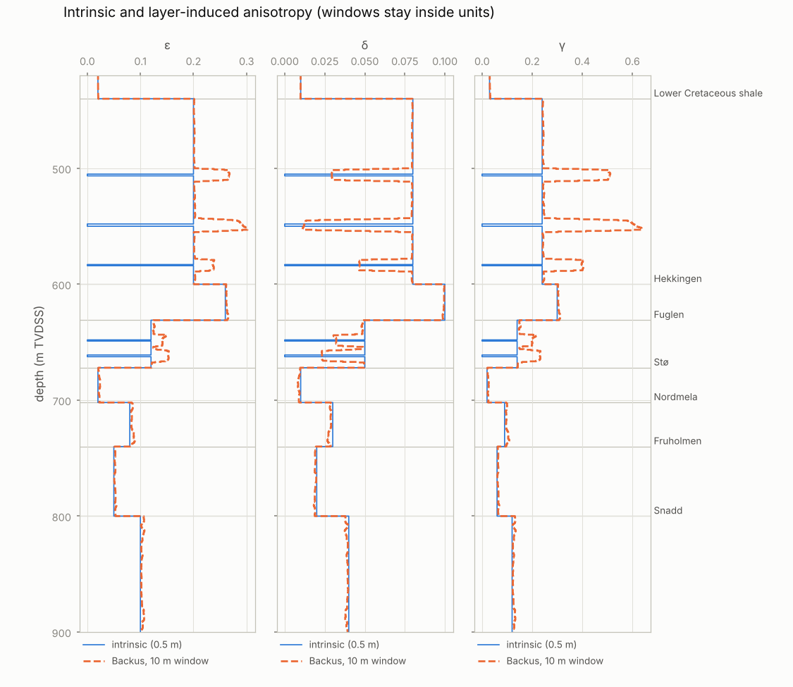

## WP2 results (synthetic well; `python examples/wp2_forward_modelling.py`)

**Validation.** The two independent PP-coefficient codes agree. The explicit Aki & Richards
Zoeppritz formula and the eigenvector solution differ by less than 10⁻¹⁵ from 0 to 60°.

At normal incidence the reflectivity method equals the convolution synthetic to 2·10⁻¹⁴ on all
2524 layers. This holds with transmission loss and Q, for primaries only and no free surface.

The point-source integration was checked three ways:

- **Direct wave:** it matches the analytic e^{ikR}/R pressure to 10⁻⁴.
- **Seabed reflection:** it matches the image-source wave scaled by R(θ) to 2 %.
- **Vertical attenuation:** it matches `iwt.qmodel` to 10⁻¹⁰.

Interface scattering conserves energy and is reciprocal. 67 tests in all at WP2.

**AVO at the reservoir.** Unit Backus averages, with R at 0 / 20 / 40°:

| Interface | exact isotropic | exact VTI | Rüger | Aki–Richards |
|---|---|---|---|---|
| top Stø (Δε = −0.116, Δδ = −0.029) | −0.046 / −0.064 / −0.110 | −0.046 / −0.068 / −0.132 | −0.046 / −0.068 / −0.134 | −0.046 / −0.065 / −0.111 |
| top Fruholmen (Δε = −0.034, Δδ = −0.009) | +0.096 / +0.075 / +0.048 | +0.096 / +0.074 / +0.044 | +0.096 / +0.074 / +0.032 | +0.096 / +0.075 / +0.039 |

- **Anisotropy matters at top Stø.** The anisotropic Fuglen shale over an almost isotropic sand
  makes the far-angle amplitude 20 % stronger than isotropic modelling predicts: R(40°) is −0.132
  against −0.110. This is the effect the article needed VTI for.
- **Rüger is reliable to about 30°** (error ≤ 0.002). Near the critical angle it fails: at top
  Fruholmen at 40° it reads 0.032 against an exact 0.044. Use the exact coefficient for far
  angles.

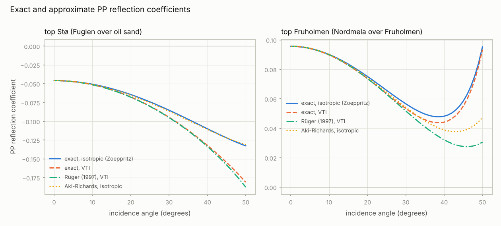

**Transmission loss and short-period multiples.** At normal incidence the two-way transmission
product through the 509 fine-layer interfaces above top Stø is only 0.25. Yet the full response
in the reservoir window has 0.89 times the amplitude of the Born (single-scattering, no
transmission loss) primaries. Short-period multiples restore most of the loss, as O'Doherty &
Anstey (1971) described.

Consequence for WP7: "full minus primaries-with-transmission-loss" mostly measures this
compensation. Interbed multiples are better isolated against Born primaries. The plan has been
corrected.

**Multiples in the reservoir window.** Streamer gathers, Q on, no free surface, top Stø to top
Fruholmen window, offsets 100–600 m:

- RMS(full − Born) / RMS(Born) = 0.33;
- there is no measurable time shift at 2 ms sampling.

The Quaternary and Lower Cretaceous reverberations and the calcite stringers produce this
contamination. It is the effect the article reports. At larger offsets the seabed reflection, with
its large water moveout, crosses the reservoir window in raw gathers. Quantifying the
contamination there needs moveout-corrected or migrated gathers (WP6/WP7).

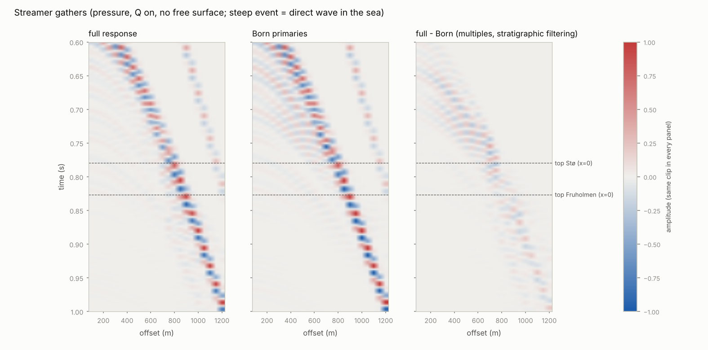

**Zero-offset VSP.** The source is 50 m from the well, with receivers at 450–900 m. The
first-arrival peak comes 4–7 ms (median 5.6 ms) after the straight vertical traveltime at 30 Hz.

*Corrected in WP3:* this delay is not caused by Q, as first written here. `Reflectivity.record`
takes the source *potential* as its wavelet, so the recorded displacement is the time derivative
of the Ricker wavelet, and the largest lobe of that derivative lies 5.57 ms from the centre for
30 Hz. With a zero-phase displacement wavelet, Q moves the peak slightly *earlier* than the 30 Hz
time (WP3 results). The pick convention still matters at the millisecond level, as WP3 shows.

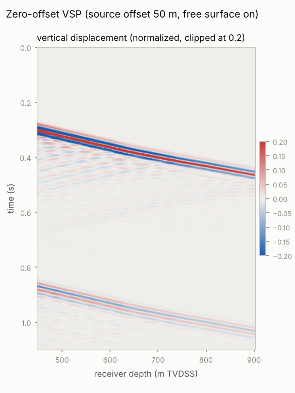

## WP3 results (synthetic well; `python examples/wp3_zovsp.py`, about 15 s)

**The data.** The "measured" ZO-VSP is a vertical-incidence reflectivity synthetic of the
Wisting-like well (assumption 10):

- source 6 m deep, with its ghost and the free surface;
- receivers every 10 m from 450 to 1650 m;
- 40 Hz zero-phase wavelet, Q on;
- band-limited noise at 0.3 % of each trace's peak.

The stratigraphic reference is an elastic (no-Q) synthetic of a 0.5 m model built from the
*logs*: the 12 kHz sonic, the dipole and the density.

**Pick conventions.** Over 450–1650 m, each traveltime is compared with the model's vertical time
at 30 Hz:

| Time | Difference over 1200 m |
|---|---|
| onset (10 % of the envelope) | −3.18 ms |
| peak (tracked) | −0.71 ms |
| phase delay at 30 Hz, downgoing wavefield | +0.68 ms |

The onset travels at the high-frequency velocity and the peak at roughly the dominant-frequency
velocity. Only the 30 Hz phase delay measures the time a 30 Hz tie needs. Its +0.68 ms is the
layering delay; the Backus average of the logs predicts 0.91 ms over the logged interval.

- **Noise.** The phase times have 0.09 ms of noise, estimated from their second differences.
- **Interval velocity at 10 m.** Plain differencing has 124 m/s RMS error. The regularized
  solution has 81 m/s, and part of that is real variability it smooths out.
- **Unit velocities.** Blocked least squares recovers them to within 1.4 % for units of 60 m
  or more, and to within 0.3–4.1 % for the 30–41 m units.

**Separation, deconvolution and corridor stack.**

- **Separation.** After the first arrival, the parametric separation leaves 0.14 of the exact
  upgoing wavefield as error (noise-free data). A 9-trace median filter leaves 0.30.
- **Corridor stack.** The 100 ms corridor stack, in SEG polarity at the sea-level datum,
  correlates with the true Born primaries at **0.982**; the plan's acceptance criterion is 0.8.
  The full stack, which includes the interbed multiples, correlates at 0.970. The corridor
  amplitude is 0.79 of the Born amplitude.

The figure shows the primaries *with* transmission loss alongside. They are far weaker at depth,
which is the O'Doherty–Anstey effect again (WP2).

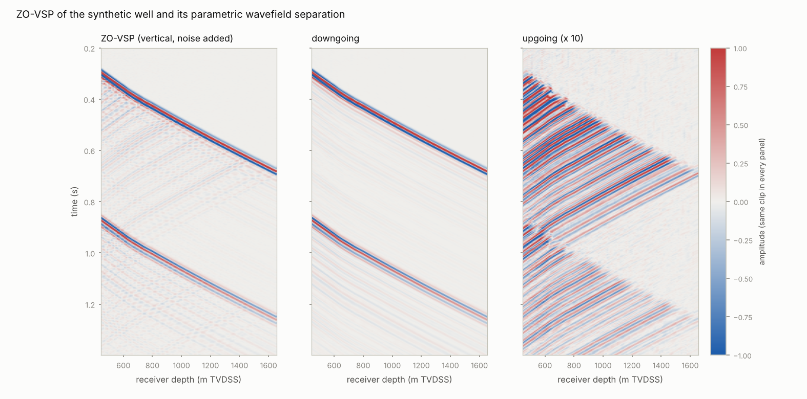
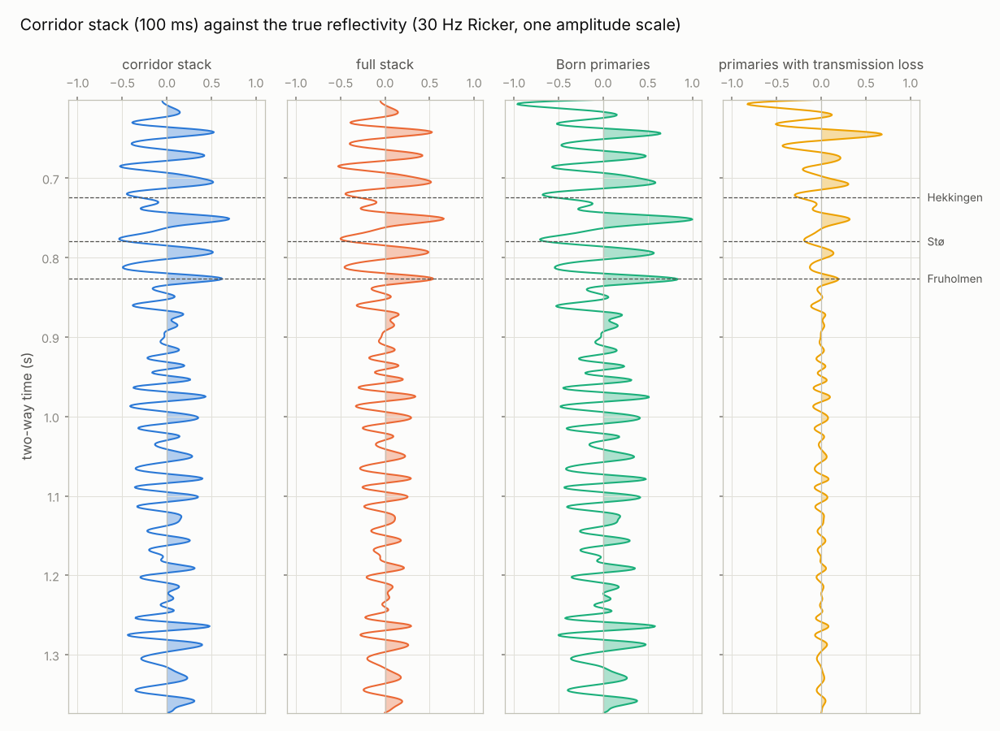

**Q: apparent, stratigraphic and intrinsic.** Values are 1/Q × 1000 per block, with the fit
standard deviation in brackets:

| Block (m) | 450–600 | 600–740 | 740–800 | 800–1650 |
|---|---|---|---|---|
| model (true intrinsic) | 21.96 | 17.01 | 12.50 | 14.29 |
| apparent, spectral ratio | 26.58 (1.9) | 21.60 (2.0) | 9.4 (4.3) | 15.23 (0.2) |
| intrinsic, spectral ratio | 23.68 (1.8) | 18.34 (2.0) | 3.3 (4.2) | 14.03 (0.2) |
| apparent, centroid shift | 23.74 (0.9) | 16.09 (1.0) | 11.6 (2.0) | 15.41 (0.1) |
| **intrinsic, centroid shift** | **21.84 (0.5)** | **16.64 (0.6)** | 8.2 (1.2) | **13.90 (0.1)** |

- **The stratigraphic correction works.** Stratigraphic filtering makes the spectral-ratio Q
  21–27 % too attenuating in the upper blocks. Subtracting t* from the log-model synthetic brings
  the centroid-shift estimate within 0.5–2.7 % of the model in every block of 140 m or more.
- **The 60 m Fruholmen block is not resolved.** Its t* change is about 0.25 ms.
- **The centroid shift is the robust estimator here.** At 1 % noise its intrinsic Q stays within
  2.5–8 % in the three resolved blocks. Its error bars are about 4.5 times smaller than the
  spectral ratio's, which grow threefold between 0.3 % and 1 % noise.
- **The stratigraphic part depends on the band and the estimator,** because stratigraphic
  filtering is not constant-Q. Apparent and stratigraphic t* must therefore be measured with the
  same windows, band and estimator.

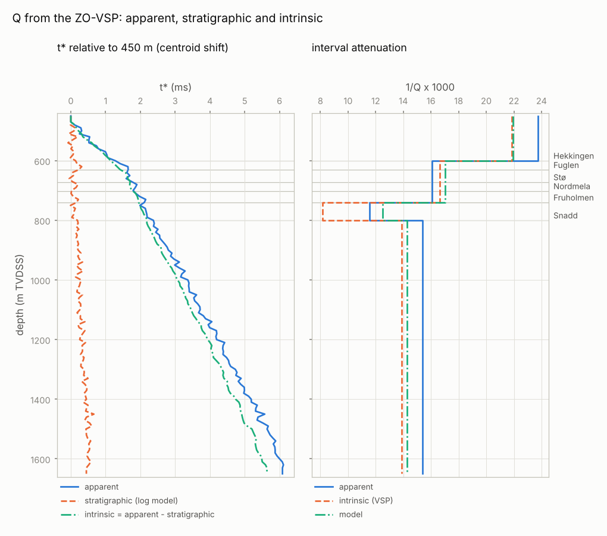

**Drift and calibration.** The drift is the VSP time minus the integrated 12 kHz sonic, tied at
470 m:

| Drift at | 600 m | 800 m | 1200 m | 1650 m |
|---|---|---|---|---|
| onset picks | 1.76 | 3.55 | 5.83 | 8.14 ms |
| peak picks | 2.17 | 4.25 | 7.32 | 10.51 ms |
| 30 Hz phase delays | 2.62 | 4.83 | 8.36 | 11.89 ms |
| intrinsic dispersion alone | 2.15 | 4.21 | 7.55 | 11.07 ms |

The pick convention alone changes the drift at TD by 30 % (8.1 against 11.9 ms).

Residual drift after calibration, against the 30 Hz phase delays:

| Calibration | RMS | At 1650 m |
|---|---|---|
| knee (knees at 600, 740, 800 m), fitted to the drift | 0.10 ms | −0.12 ms |
| model Q + Backus (40 m) | 0.12 ms | −0.10 ms |
| **intrinsic VSP Q (spectral ratio) + Backus** | **0.13 ms** | **+0.02 ms** |
| **intrinsic VSP Q (centroid) + Backus** | **0.22 ms** | **+0.28 ms** |
| apparent VSP Q (centroid) + Backus | 0.38 ms | −0.71 ms |
| apparent VSP Q (spectral ratio) + Backus | 1.02 ms | −1.40 ms |
| apparent VSP Q (spectral ratio), no Backus | 0.34 ms | −0.46 ms |

- **The physical calibration explains the 11.9 ms drift to 0.1–0.3 ms RMS** with no parameter
  fitted to the drift: Q comes from the VSP amplitudes and the layering term from the logs. It
  is almost as good as the fitted knee correction. The knee correction cannot say why the drift
  exists, and it builds the dispersion into the velocities, so Q-compensated imaging would then
  apply it a second time.
- **Using the apparent Q together with the Backus term counts the layering twice** (−0.7 to
  −1.4 ms at TD).
- **Using the apparent Q without the Backus term happens to work almost as well.** Stratigraphic
  filtering is causal (O'Doherty & Anstey, 1971; Banik et al., 1985), so its delay partly
  mimics constant-Q dispersion. The consistent pair is intrinsic Q with Backus.

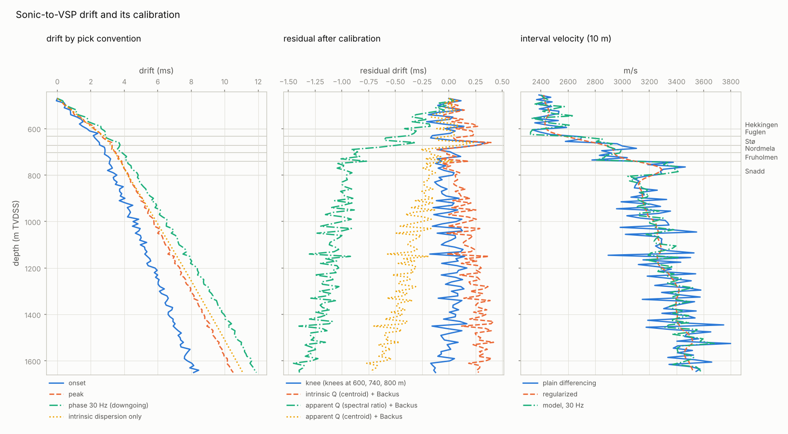

## WP4 results (synthetic well; `python examples/wp4_sonic_anisotropy.py`, about 50 s)

**The data.**

- **Stoneley log:** "measured" at 500 Hz with a rigid 46 mm-radius tool, in mud of 1540 m/s and
  1250 kg/m³ (assumption 15). It is computed with the exact TI borehole mode in the Backus
  average of the model over a 1.8 m array, with 0.3 % noise.
- **Borehole:** the bit radius is 108 mm. Washouts enlarge it by up to about 10 % in the
  overburden shales, and the caliper reads it with 1 mm noise.
- **Processing:** assumes a mud velocity of 1500 m/s unless the mud is calibrated.
- **Truth:** γ of the Backus medium over the same 1.8 m.

**The Stoneley wave is leaky in the overburden shales.** In the Lower Cretaceous shale and
the Hekkingen, the tube wave is faster than the shear wave travelling along the borehole: it is
controlled by C66 (γ ≈ 0.3), the shear wave by C44 (Vs0 ≈ 950–1050 m/s). The Stoneley wave
therefore radiates shear energy into the formation.

Slowness relative to the tube wave, unit averages:

| Unit | 500 Hz | 1 kHz | radiation 1/Q at 500 Hz | at 500 Hz, ε = δ = 0 | at 500 Hz, isotropic with μ = C66 |
|---|---|---|---|---|---|
| Lower Cretaceous shale (leaky) | 1.0188 | 1.0596 | 0.0099 | 1.0205 | 1.0077 |
| Hekkingen (leaky) | 1.0138 | 1.0398 | 0.0034 | 1.0157 | 1.0049 |
| Stø | 1.0007 | 0.9983 | 0 | 1.0007 | 1.0004 |
| Fruholmen | 1.0000 | 0.9972 | 0 | 1.0000 | 0.9995 |

- **The leaky mode turns into a trapped one at about 1.2–2 kHz.** Near that transition the measured
  slowness alone is ambiguous (see the notes), so the Stoneley wave is best analysed at
  ≤ 500 Hz.
- **The measured C44 matters more than the unknown C11 and C13.** At 500 Hz, the TI mode with
  ε = δ = 0 is 0.2 % off. The usual isotropic substitute, which ignores the measured C44, is
  1.1 % off. In slowness that error is amplified about 3.5 times in C66.

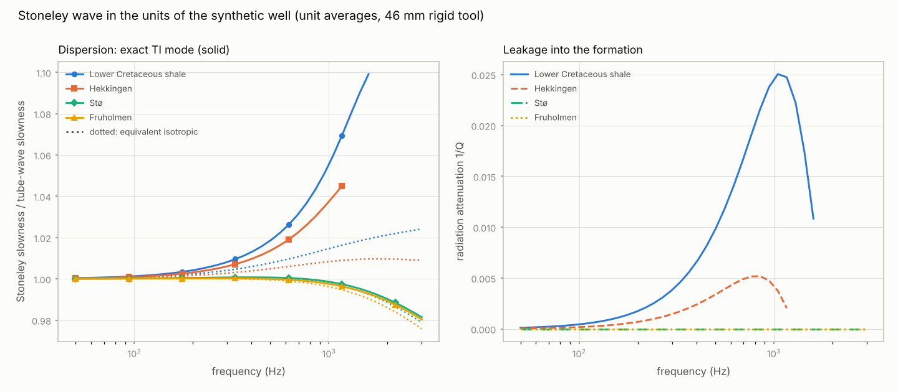

**The processing ladder.** Each step adds one correction. Errors are the γ estimate minus the
true sonic-scale γ, as unit means:

| Step | L. Cret. | Hekkingen | Fuglen | Stø | Nordmela | Fruholmen | Snadd | RMS |
|---|---|---|---|---|---|---|---|---|
| true γ | 0.267 | 0.303 | 0.159 | 0.023 | 0.095 | 0.063 | 0.122 | |
| A tube wave, no tool, nominal mud, bit size | −0.167 | −0.144 | −0.096 | −0.059 | −0.078 | −0.039 | −0.045 | 0.088 |
| B + tool term | −0.034 | +0.003 | +0.028 | +0.044 | +0.036 | +0.078 | +0.083 | 0.092 |
| C + caliper | −0.050 | −0.019 | +0.020 | +0.044 | +0.036 | +0.077 | +0.083 | 0.092 |
| D + dispersion (exact TI mode, ε = δ = 0) | +0.006 | +0.027 | +0.034 | +0.045 | +0.044 | +0.077 | +0.084 | 0.093 |
| D′ as D, isotropic substitute | −0.030 | −0.007 | +0.025 | +0.043 | +0.038 | +0.073 | +0.078 | 0.088 |
| E + dipole C44 moved to 500 Hz, matched resolution | +0.053 | +0.065 | +0.068 | +0.058 | +0.061 | +0.095 | +0.104 | 0.104 |
| F + mud calibrated in the Stø, assumed isotropic (1563 m/s) | −0.012 | −0.010 | −0.027 | −0.023 | −0.024 | −0.035 | −0.041 | 0.045 |
| **G as E with the true mud (1540 m/s)** | **+0.009** | **+0.014** | **+0.003** | **+0.003** | **+0.003** | **+0.004** | **+0.003** | **0.029** |

- **The tool term is the largest single correction.** It raises γ by 0.10–0.15.
- **With all corrections and the right mud slowness, every unit is within 0.014** (G). The
  remaining RMS of 0.029 is noise and thin-bed spikes.
- **The mud slowness decides the result.** A 2.7 % error (1500 against 1540 m/s) shifts γ by
  +0.05 to +0.10 (E), more than every other correction. It also hides whether the other
  corrections are right: D and E look worse than C only because the mud error dominates.
- **Calibrating the mud in the Stø under the assumption that it is isotropic** gives 1563 m/s:
  its true γ is 0.023. The result is then γ errors of −0.01 to −0.04. In a real well the
  Stø is permeable, which would also raise its Stoneley slowness (Winkler et al., 1989) and
  bias such a calibration further.

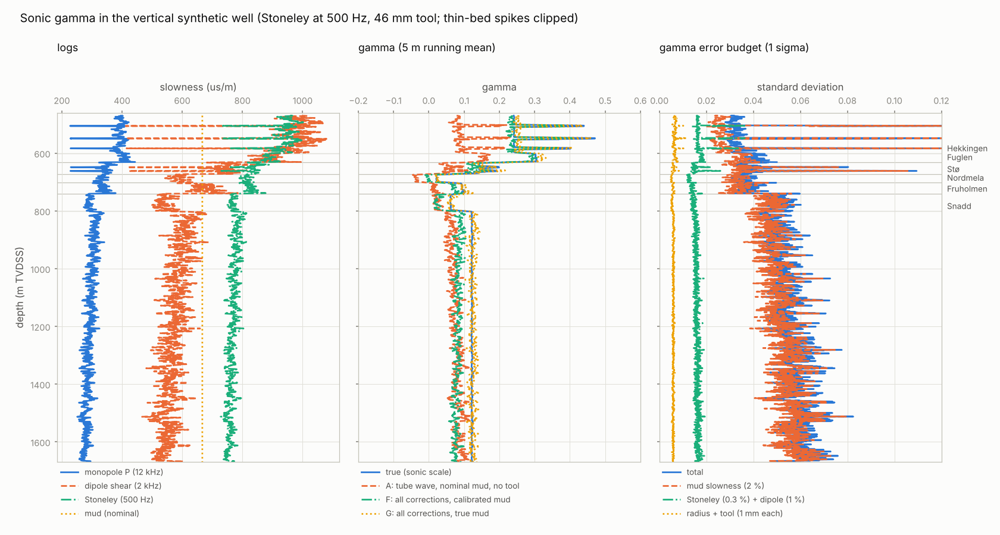

**The uncertainty budget.** Linear propagation for the final processing, with 1σ input
errors:

- mud slowness 2 %, mud density 1 %;
- Stoneley slowness 0.3 %, dipole slowness 1 %;
- density 15 kg/m³;
- radius and tool radius 1 mm each.

It is checked by Monte Carlo (4000 draws), which agrees to 0.001–0.003.

| Unit (median) | L. Cret. | Hekkingen | Fuglen | Stø | Nordmela | Fruholmen | Snadd |
|---|---|---|---|---|---|---|---|
| σ(γ), total | 0.033 | 0.041 | 0.039 | 0.035 | 0.038 | 0.050 | 0.055 |
| from the mud slowness | 0.026 | 0.035 | 0.034 | 0.032 | 0.034 | 0.047 | 0.052 |
| from the dipole | 0.014 | 0.015 | 0.012 | 0.010 | 0.011 | 0.010 | 0.011 |
| from the Stoneley | 0.008 | 0.010 | 0.009 | 0.008 | 0.008 | 0.010 | 0.011 |

- **The mud slowness dominates, as the plan expected.** Its effect grows in fast rock, where
  S_T² − S_f² is small.
- **In the fast sands and the Snadd, σ(γ) ≈ 0.04–0.055.** That is as large as γ itself, so
  sonic γ there is only an upper-bound indicator.
- **In the overburden shales (γ ≈ 0.3) it is well resolved.** Those are the units where the
  article needed the anisotropy.

## WP5 results (synthetic well; `python examples/wp5_walkaway.py`, about 45 s)

**The survey.** Sources every 25 m from 200 m (the article's exclusion zone) to 2500 m on both
sides of the well, at 6 m depth; receivers every 10 m from 600 to 900 m. Picks carry 0.2 ms and
polarizations 1.5° of noise. The rays are traced through the 40 m running Backus average of the
well model, so the slowness across a 40 m sub-array and the polarization at its receivers see
the same medium; that average is also the truth. Each of the six levels (650–850 m) uses five
receivers. Priors: Vp0 from the ZO-VSP (1 %, drawn around the truth), Vs0 from the dipole log
over the sub-array (5 %), Backus-averaged and moved to 30 Hz.

**Fast stringers limit the angles, as in the article.** Beyond the critical offset of the
calcite-cemented stringers above 600 m the first arrival is a refraction, so direct rays reach
only 775–1450 m of offset, and 23–78° at the levels. The 30–60° window keeps 27–40 sources per
level. The article's "about 30° to 60°" may have the same cause.

| Level (unit) | true ε | A: exact, slowness + polarization | B: slowness only | C: weak anisotropy | D: as A, all angles | true δ | A | B | D |
|---|---|---|---|---|---|---|---|---|---|
| 650 m (Fuglen) | 0.145 | 0.132 ± 0.007 | 0.160 ± 0.014 | 0.168 ± 0.015 | 0.135 ± 0.006 | 0.038 | 0.044 ± 0.019 | −0.043 ± 0.039 | 0.056 ± 0.015 |
| 690 m (Stø) | 0.038 | 0.048 ± 0.005 | 0.034 ± 0.014 | 0.034 ± 0.014 | 0.050 ± 0.005 | 0.009 | −0.018 ± 0.013 | −0.003 ± 0.043 | −0.017 ± 0.009 |
| 720 m (Nordmela) | 0.084 | 0.081 ± 0.005 | 0.071 ± 0.014 | 0.067 ± 0.014 | 0.084 ± 0.005 | 0.026 | 0.024 ± 0.015 | 0.130 ± 0.053 | 0.012 ± 0.010 |
| 770 m (Fruholmen) | 0.053 | 0.049 ± 0.006 | 0.044 ± 0.019 | 0.043 ± 0.019 | 0.049 ± 0.005 | 0.019 | 0.027 ± 0.018 | 0.036 ± 0.052 | 0.024 ± 0.012 |
| 810 m (Snadd) | 0.093 | 0.100 ± 0.006 | 0.093 ± 0.014 | 0.096 ± 0.014 | 0.109 ± 0.005 | 0.031 | 0.033 ± 0.017 | −0.018 ± 0.040 | 0.042 ± 0.011 |
| 850 m (Snadd) | 0.102 | 0.103 ± 0.006 | 0.104 ± 0.015 | 0.101 ± 0.015 | 0.102 ± 0.005 | 0.039 | 0.043 ± 0.016 | 0.070 ± 0.049 | 0.045 ± 0.010 |
| RMS of (estimate − truth)/σ | | 1.25 | 0.65 | 0.87 | 1.75 | | 0.86 | 1.29 | 1.44 |

- **The polarization halves the ε error and triples the δ precision** (A against B), but its
  errors are no longer honest: inverting the *noise-free* data gives ε within 0.005 of the
  truth only at three levels (0.131 against 0.145 at 650 m, 0.056 against 0.038 at 690 m). The
  properties vary inside the 40 m sub-array, and the slowness (an average across it) and the
  polarization (at each receiver) do not see quite the same medium. That model error, about
  0.01 in ε, is not in the posterior σ; add it before using the numbers.
- **Without polarization (B) Vp0 is set by its prior** (data weight 0.04–0.09 at 30–60°,
  against 0.67–0.76 with polarization). The ZO-VSP Vp0 is therefore essential, not optional.
- **The weak-anisotropy formula (C) is as good as the exact one at these levels** (ε ≤ 0.15). It
  fails in the strongly anisotropic overburden: in a test with ε = 0.26, δ = 0.10 it puts δ
  more than 2σ too high, where the exact fit is within 1σ.
- **The raw dipole Vs0 (4–5 % fast: sonic frequency and scale) moves ε by only −0.001 to
  −0.003** here, because the data weight on Vs0 is small and ε is well determined. With the
  polarization, ε and δ do depend on Vs0 (next point), so the bias matters more where the
  anisotropy is strong.
- **More angles (D, 23–78°) shrink the errors by 20–40 % but not the bias** of the
  slowness-polarization mismatch; D has the worst z-scores.

**The near-angle trade-off** (770 m, angles up to 60°):

| smallest angle | 20° | 30° | 35° | 40° |
|---|---|---|---|---|
| σ(δ) | 0.015 | 0.018 | 0.022 | 0.029 |
| corr(ε, δ) | +0.30 | +0.37 | +0.46 | +0.61 |
| corr(Vp0, δ) | −0.73 | −0.76 | −0.80 | −0.84 |
| Vp0 data weight | 0.73 | 0.67 | 0.57 | 0.33 |

Losing the near angles hands Vp0 to its prior and makes δ trade off with it. The 200 m exclusion
zone is what costs the angles below 23–30° here.

**Consistency checks.**

- **Second azimuth (VTI):** χ² p-values 0.17–0.99 at the six levels. In the test suite, a
  second azimuth with ε larger by 0.05 gives p < 10⁻⁶.
- **Lateral heterogeneity:** a source static growing by 5 ms per km of offset biases the
  slowness-only δ by up to 0.11 (720 m: 0.137 against 0.026). The polarization check flags it
  at four of six levels at the 5 % level (p = 0.0004–0.025), and not at 770 and 810 m (p ≈ 0.3).
  The check is weak with 27–40 sources; it needs either more angles or a stronger static.
- **Heterogeneity inside the sub-array:** with the rays traced through the 10 m Backus model
  instead, the noise-free estimates miss the 40 m truth by up to 0.027 in ε (650 m, next to the
  Fuglen stringers) while χ²/n stays at 0.01–0.11. The fit statistics cannot see this error.

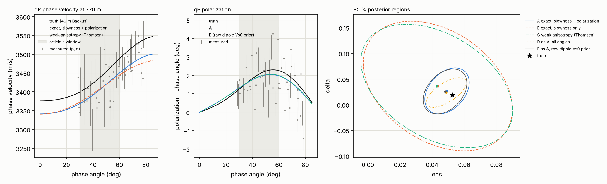

**The γ → (ε, δ) calibration** (method A at the six levels; sonic γ from the WP4 processing with
the mud calibrated in the Stø, upscaled to 40 m with C66 arithmetic and C44 harmonic):

- ε = 0.036 (±0.006) + 0.64 (±0.07) γ, extra scatter 0.006; δ = −0.005 (±0.014) + 0.38 (±0.17) γ,
  extra scatter 0.010. Leave-one-out z-scores are within ±1.8.
- The sonic γ is 0.025–0.038 too low at the levels: the WP4 mud calibration in the "isotropic"
  Stø, whose true γ is 0.02. Upscaling exact logs reproduces the truth to 0.003. The calibration
  absorbs a *constant* offset into its intercept, but not one that varies with depth.

| (prediction − truth), 40 m scale | overburden 470–640 m | calibrated 640–860 m | below 860–1670 m |
|---|---|---|---|
| ε: RMS / mean predictive σ / truth inside 2σ | 0.015 / 0.017 / 95 % | 0.007 / 0.007 / 94 % | 0.014 / 0.007 / **51 %** |
| δ: RMS / mean predictive σ / truth inside 2σ | 0.036 / 0.038 / 100 % | 0.013 / 0.014 / 100 % | 0.012 / 0.013 / 100 % |

- **Extrapolating into the overburden works here,** but only because the synthetic units share
  one ε/γ ratio and the sonic γ bias is similar there. Below 860 m the γ bias grows (WP4:
  −0.041 in the Snadd), and half of the ε curve falls outside its 2σ band. The predictive band
  from six points does not include errors of the γ log that change with depth.
- **Circularity is mild with polarizations:** adding a prior ε ~ N(γ, 0.05) to the inversion, as
  the article's "stabilized with sonic γ" suggests, leaves the data weight on ε at 0.98–0.99
  and the calibrated slope unchanged (0.64). It would matter for slowness-only inversions, whose ε
  errors are 2–3 times larger.

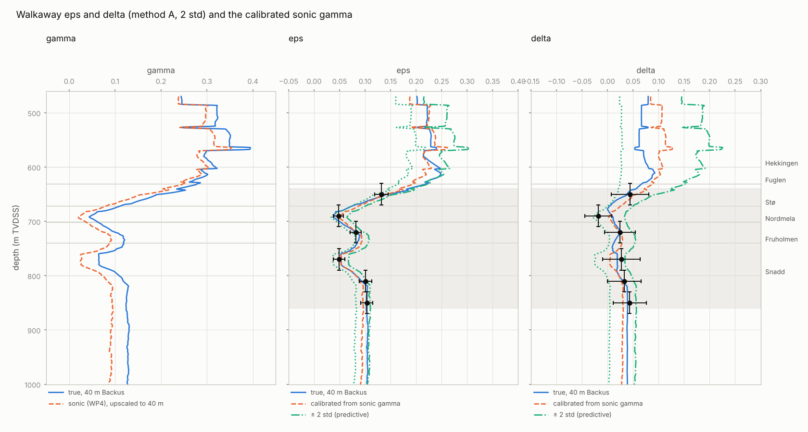

**Estimator properties found in the tests** (homogeneous VTI half-space under 400 m of water):

- **Measurement covariance:** the propagated variances of p, q and ψ agree with Monte Carlo
  within 10 %, including the lag-1 correlation of p (+0.4) from overlapping source windows.
- **Coverage:** slowness-only fits with priors drawn around the truth have z-scores with standard
  deviation 0.97–1.05 and no measurable bias. With polarizations there is an
  errors-in-variables bias of about 0.5σ (Vp0 low, ε and δ high), which scales with the noise
  variance; orthogonal-distance regression and a parametric bootstrap removed most of it for Vp0
  and ε but not for δ, so neither was adopted.
- **The P-wave phase velocity barely depends on Vs0;** with polarizations ε and δ do (Grechka &
  Mateeva, 2007: the P-wave slowness-polarization data depend on Vp0 and two combinations of ε
  and δ that absorb Vs0). A 10 % error in the Vs0 prior shifts ε by more than half its σ with
  polarization, and by less than a tenth without.

## WP6 results (synthetic well; `python examples/wp6_imaging.py`, about 90 s)

**The experiment (the article's Fig. 3).**

- **Data:** point-source CMP gathers from the reflectivity method (WP2), offsets 100–1500 m,
  explosion at 6 m and hydrophones at 8 m, a 30 Hz Ricker source, Born primaries without free
  surface or converted waves. The "observed" gather has the model's Q; the "elastic synthetic"
  has none and is the reference.
- **Processing:** the direct wave and the seabed reflection are muted. The seabed reflection
  crosses the Stø reflection at about 1150 m of offset (54°), so the AVA uses offsets up to
  850 m (44°). All variants are migrated with an 80 Hz high cut and gain limit 10.
- **Migration models:** 20 m Backus averages of the well model. The VTI model has the true ε and
  δ. The isotropic models use either the vertical Vp0, which ties the well, or the NMO velocity
  Vp0 √(1 + 2δ), which flattens near-offset gathers as an isotropic velocity analysis would.
- **Score:** the Stø-top AVA against the reference. Intercept A and gradient B (A + B sin²θ over
  20–44°), and the RMS misfit of the AVA curve relative to its RMS.

**Kinematics at the Stø top.** The overburden is strongly anelliptic. Fitting the exact
layered-VTI times with the Alkhalifah & Tsvankin (1995) equation gives η ≈ 0.19–0.23 and
V_nmo ≈ 1820 m/s, with errors of at most 0.71 ms out to offset/depth 2.

- **The NMO-velocity isotropic model** images the Stø 16 m too deep (688 m). Its errors at the
  reflector are +7 ms and +7° at 45°.
- **The vertical-Vp0 isotropic model** ties the depth but is +16 ms and +9° off at 45°.

| variant | Stø pick depth (m) | moveout 20→44° (m) | A / A_ref | B / B_ref | AVA misfit |
|---|---|---|---|---|---|
| reference: elastic data, VTI migration | 667.9 | +0.7 | 1.00 | 1.00 | 0 |
| VTI, no Q compensation | 667.1 | −1.6 | 0.65 | 0.24 | 0.53 |
| **VTI + Q compensation** | 667.9 | +0.5 | **1.02** | **0.96** | **0.014** |
| VTI + phase-only Q | 667.8 | +0.3 | 0.66 | 0.23 | 0.53 |
| VTI + Q compensation, Q 30 % too low | 668.3 | +1.0 | 1.22 | 1.58 | 0.37 |
| isotropic (NMO v), no Q compensation | 682.8 | −8.6 | 0.55 | 0.24 | 0.59 |
| isotropic (NMO v) + Q compensation | 683.6 | −5.6 | 0.85 | 0.84 | 0.16 |
| isotropic (vertical Vp0) + Q compensation | 667.7 | −11.9 | 0.69 | 0.88 | 0.24 |

- **The article's ranking is reproduced: anisotropic PSDM with Q compensation ties best**
  (misfit 0.014). Isotropic PSDM with Q compensation comes next (0.16–0.24).
- **Anisotropic PSDM without Q is much worse here than the article's "OK"** (misfit 0.53,
  gradient 24 % of the reference). Overburden Q of 40–60 removes 35 % of the intercept and most
  of the gradient: t\* grows from 5 to 7 ms across 20–44°. So either the real overburden
  attenuates less than this synthetic, or the article's "OK" is generous. Phase-only
  compensation fixes the timing (the event moves 0.7 m) but not the amplitudes.
- **Q compensation is as sensitive to Q as anisotropy is to ε and δ.** A Q model 30 % too low
  (an apparent instead of an intrinsic Q, for example) overshoots the gradient by 58 % and the
  intercept by 22 %. This is the double-counting risk of the plan's critical point 4.
- **The isotropic NMO-velocity image** has the right intercept to 15 % after Q compensation,
  but it is 16 m too deep. It also curves 6 m between 20° and 44° (residual moveout from η), and
  the angles it assigns are up to 7° too large.
- **The Stø-top amplitude is not the Fuglen/Stø interface's.** The stringers 11 and 24 m above
  tune it: the single-interface coefficient on the same scale has 57 % of the intercept and
  89 % of the gradient. An interface-based AVA interpretation must model the whole stack (WP7).

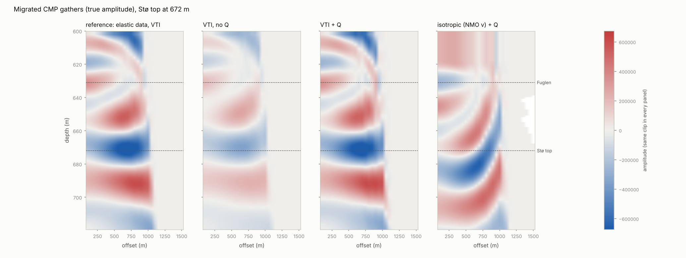

**True amplitude and the Q operators** (checks in the example and the tests):

- **Spreading:** migrated amplitude ÷ exact plane-wave R is constant to 0.7 % over 20–44°.
  The interface is a single Fuglen/Stø contact, with no Q. The scale is the source and
  wavelet constant.
- **Q compensation in migration:** in the tests, it reproduces the no-Q amplitudes to 1 %
  below 25° and to 3 % up to 35°.
  - The small remaining under-compensation comes from the first-order (in 1/Q) operator, and
    from the modelling's shear Q, which also attenuates oblique P waves.
  - The direct wave and the seabed reflection must be muted first. Otherwise the inverse filter
    rings near the high cut and leaks their energy, which is 3–100 times larger, onto the
    target.
- **Gain limit:** with an 80 Hz high cut, the AVA misfit falls from 0.22 (gain 2) to 0.016
  (gain 10) and then levels out. With noise at 5 % and 20 % of the signal RMS, it levels out at
  0.028 and 0.15.
  - The high cut and the gain limit are two forms of the same regularization. Beyond a gain
    of about 10 the noise, not the operator, sets the error.
  - Cavalca et al.'s noise amplification is visible only without a high cut.

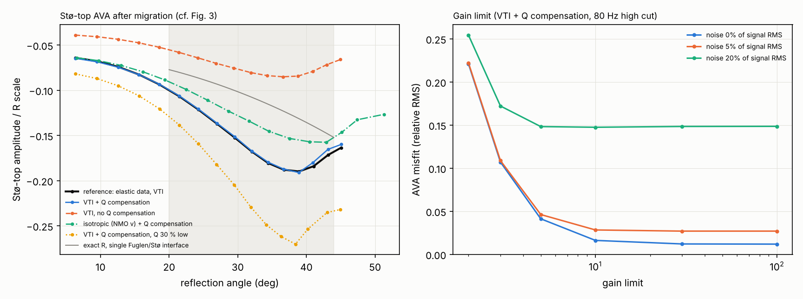

## WP7 results (synthetic well; `python examples/reproduce_paper.py`, about 6 min with 4 workers)

**The loop.** One script runs the article's workflow (its Fig. 1) using estimated models only:
logs, then the ZO-VSP, then the walkaway, then the surface seismic. The true earth is used for
scoring. In the entries marked *synthetic only*, it also attributes misfits that field data
could not attribute. Every model version, discrepancy and acceptance criterion is written to
[`docs/discrepancy_register.md`](docs/discrepancy_register.md).

| version | from | change |
|---|---|---|
| v0 | logs | sonic, dipole and density as logged (12 kHz, 2 kHz); isotropic; no Q |
| v1 | + ZO-VSP | Vp moved to 30 Hz with the VSP intrinsic Q; Qs = Qp/2; the blind gap above the logs (417.5–470 m) filled from the VSP |
| v2 | + walkaway | ε and δ from the sonic γ through the walkaway calibration |
| (v3) | + "rock-physics" Vs | dipole Vs moved to 30 Hz with Qs = Qp/2: tested and rejected |

**1. ZO-VSP (Fig. 2 analogue, left).**

- **Intrinsic Q per block:** 46, 60, 123 and 72 (true 46, 59, 80 and 70). The thin Fruholmen
  block (60 m) is the poorly constrained one.
- **Drift (VSP minus integrated sonic):** 11.9 ms at 1650 m, 7.5 ms RMS. After the physical
  calibration the residual is 0.22 ms RMS.
- **Corridor stack against the v1 synthetic:** with the gap above the logs filled from the first
  10 m of logs, the correlation is −0.06 and the shift 8 ms. With the VSP interval velocity in
  the gap (2129 m/s; true 2067 m/s), the correlation is 0.93 (0.97 after the best shift and
  rotation), the shift +1.3 ms and the phase +4°.
- **The 52 m blind interval between the seabed and the first log controls the tie.** In this
  synthetic, a model built from logs alone does not tie a reservoir 250 m below the seabed.

**2. Anisotropy.**

- **Walkaway ε** (true 40 m value) at 650, 690, 720, 770, 810 and 850 m: 0.145 (0.145),
  0.060 (0.038), 0.082 (0.084), 0.049 (0.053), 0.103 (0.093) and 0.101 (0.102). δ is off by up
  to 0.03.
- **Calibration:** ε = 0.039 + 0.66 γ and δ = −0.007 + 0.49 γ.
- **Unit means of the calibrated curves** (true values in brackets):
  - δ is 0.035–0.04 too high in the shallow shales: Lower Cretaceous 0.117 (0.077) and
    Hekkingen 0.135 (0.100);
  - Hekkingen ε is too low: 0.230 (0.260).

  Carrying the six-level calibration up into the overburden is an extrapolation, and this is
  where it fails (plan, critical point 3).

**3. Surface seismic (Fig. 2 right and Fig. 4 analogues).**

- **The measurement** is the full-physics reflectivity response of the true earth, including
  internal multiples, mode conversion and Q. Offsets run from 100 to 1000 m. There is no free
  surface: the data are assumed deghosted and free-surface demultipled.
- **Processing:** the measurement is migrated with v2 (20 m Backus, VTI, VSP Q compensation,
  gain limit 10, 80 Hz high cut). It is compared with v2's elastic synthetic, processed the
  same way without Q compensation.

| criterion (fixed before tuning) | value | threshold | passed |
|---|---|---|---|
| VSP first-break residual after calibration | 0.22 ms | ≤ 1 ms | yes |
| corridor stack vs synthetic, correlation | 0.93 | ≥ 0.8 | yes |
| reservoir event time shift (near-offset tie) | 0.02 ms | ≤ 2 ms | yes |
| Stø-top AVA gradient, contamination-free, \|predicted/measured − 1\| | 0.40 | ≤ 0.10 | **no** |
| Stø-top AVA gradient, as acquired, \|predicted/measured − 1\| | 0.73 | ≤ 0.10 | **no** |

- **The tie closes; the AVA does not.**
  - **Near offsets (≤ 300 m):** correlation 0.87 (0.98 after the best rotation), no depth
    shift, scale 0.96 and a residual phase rotation of +27°, which was not investigated
    further.
  - **As acquired**, the reservoir AVA is erratic beyond 25° (Fig. 4 analogue, top row). The
    Stø misfit is 0.62 and the predicted/measured gradient 0.27; at Fruholmen they are 1.28 and
    3.59. This reproduces the article's observation.

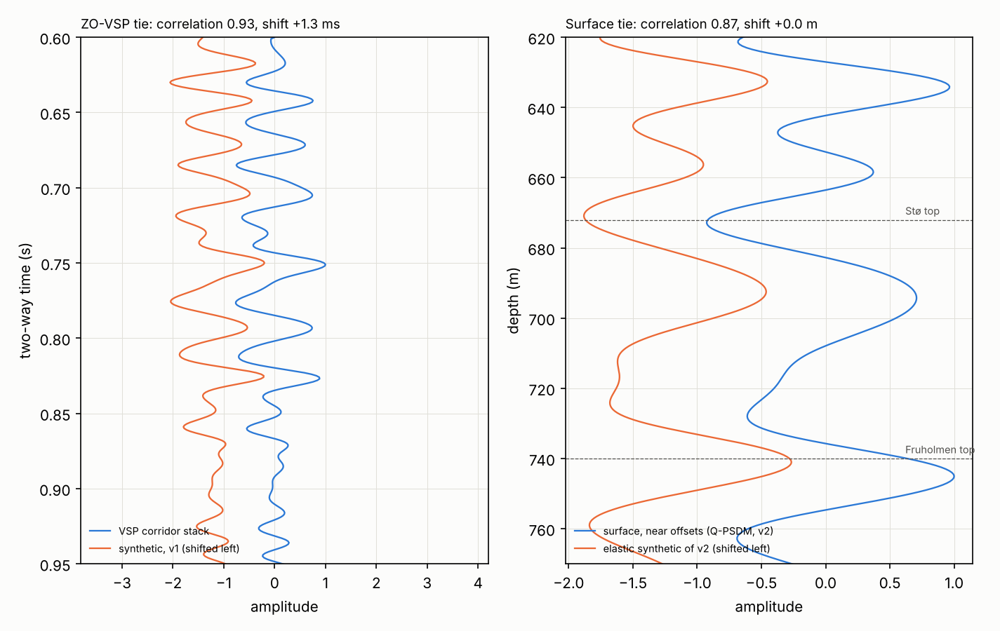

**4. Discrepancies.**

- **Contamination: elastic, and growing with angle.**
  - After identical migration, full − Born is 0.93 × Born in the Stø window and 1.53 ×
    at Fruholmen. At offsets up to 300 m it is only 0.26 and 0.40.
  - With mode conversion switched off, the P-wave interbed multiples are only 0.14 and
    0.23 × Born. The large far-offset contamination appears only with mode conversion on,
    so an acoustic (P-wave) demultiple would not repair this AVA.
  - The switches cannot split it further. The primaries with their mode conversions differ
    from Born by 1.35 × and 2.34 ×, and the multiples cancel most of that again. This
    is the elastic counterpart of the O'Doherty & Anstey (1971) cancellation.
  - "Converted waves" and "interbed multiples" are therefore not separate culprits here. The
    article's interbed multiples are, in this synthetic, elastic multiples with converted legs.
  - The remaining hypotheses are tested on contamination-free (Born) data, which is what an
    ideal demultiple would deliver.
- **"Rock-physics" Vs: rejected.** Moving the dipole Vs to 30 Hz (Qs = Qp/2) raises the
  contamination-free Stø misfit from 0.141 to 0.164 and lowers Fruholmen's from 0.062 to
  0.051, so it gives no overall improvement.
  - The identifiability study below fits the Stø residual best with Vs +3 %, the opposite
    sign to the physical dispersion correction.
  - Fitting Vs to the AVA would therefore have produced a wrong "rock-physics Vs" that
    absorbs errors made elsewhere.
- **Model or processing? (synthetic only)**
  - The true earth's own elastic prediction, processed like v2's, lies 2–14 % above the
    measurement over 20–44° (mean misfit 0.088).
  - Re-migrating the measurement with the true Q above the logs lowers the misfit to 0.056;
    with the true Q everywhere it falls to 0.040. That is the floor set by the first-order Q
    operator and the shear Q.
  - The cause: the VSP has no receivers between the seabed and 450 m, so the Quaternary (true
    Q 30) takes the first block's Q of 46. This leaves about 3 % of amplitude error at the
    reservoir that no reservoir parameter should absorb.
- **Can the model error be split one part at a time? (synthetic only) No.**
  - Swapping parts of v2 into the true earth gives a Stø misfit of 0.40 with v2's ε and δ, and
    0.23 with v2's Vp, Vs and ρ. With both parts (that is, v2 itself) it is 0.14.
  - The cause: the 5 m-smoothed γ gives the isotropic calcite stringers the shale's
    anisotropy, ε 0.13–0.15 and δ 0.06–0.07 instead of 0.
  - On the sharp 4300 m/s stringers of the true earth, this lowers their critical angle from
    about 40° to about 35°, and the predicted Stø amplitude collapses beyond about 33°.
  - In v2 the stringers are also smoothed, by the log apertures (3800 m/s instead of 4300 m/s
    for the 1 m stringer), so the two errors partly cancel.
- **Identifiability: the reservoir AVA alone cannot choose between the article's
  explanations.**
  - The contamination-free Stø residual (measured/predicted − 1) is +13 % to +20 % over
    20–38° and −12 % at 44°.
  - Each candidate alone explains only part of it, leaving 56–94 % of its RMS: Vs below
    +3.1 %, Vs above −4.5 %, ρ below −3.1 %, δ below −0.078, ε below −0.073, or a 20 % change
    of the overburden Q.
  - Fitted jointly, with 2 % noise per angle, the data constrain ρ below (data weight 0.89)
    and the overburden Q (0.60). They barely constrain the Vs on either side (0.38 and 0.17)
    and not δ (0.05).
  - Vs below and the overburden Q correlate +0.59 in the posterior. The overburden Q, which
    the true-earth test identifies as a real culprit here, trades off against the reservoir Vs.

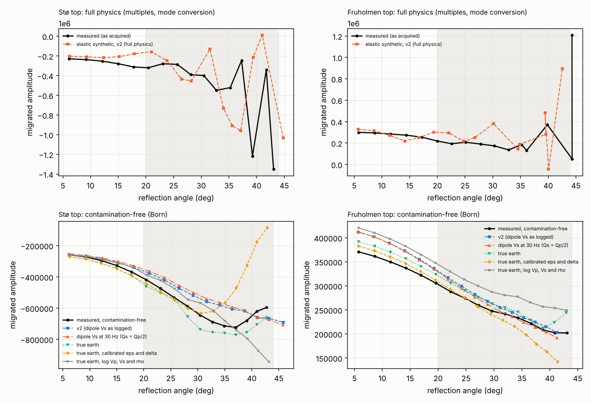

**5. Fig. 5 analogue.**

- **The section:** zero-offset columns every 20 m over 1 km. The Hekkingen shale thickens at
  1.2°, so the reservoir dips under a flat oil–water contact at 694.5 m and the oil column
  thins from 22.5 to 1.5 m.
- **The fluid signal** is the image of an oil section minus that of an all-brine twin (5 %
  noise). Both are migrated with the 20 m Backus averages of the true
  oil-section models.

| imaging | fluid-signal depth (m) | half-max thickness (m) | peak / noise RMS |
|---|---|---|---|
| VTI + Q compensation | 683.9 | 43.2 | 13.6 |
| VTI, no Q compensation | 681.3 | 44.6 | 16.7 |
| isotropic (NMO velocity) + Q compensation | 700.8 | 45.2 | 13.8 |
| isotropic (NMO velocity), no Q compensation | 698.0 | 46.5 | 16.7 |

- **Anisotropy positions the fluid signal.** VTI places it inside the oil column (top Stø at
  672–693 m, contact at 694.5 m). The isotropic NMO-velocity image puts it 17 m deeper, below
  the contact.
- **Q compensation hardly sharpens it here.** It thins the signal by only 3 %, and it costs
  signal-to-noise (16.7 → 13.6) in 1D at zero offset.
- **What this 1D test lacks.** The article's clearer contact (its Fig. 5) needs 2D/3D
  migration, where restored high frequencies help focus a flat event against dipping ones.
- **At 30 Hz the 2–22 m oil column is below tuning thickness everywhere,** so the contact
  cannot be seen in the oil section itself (second panel below).

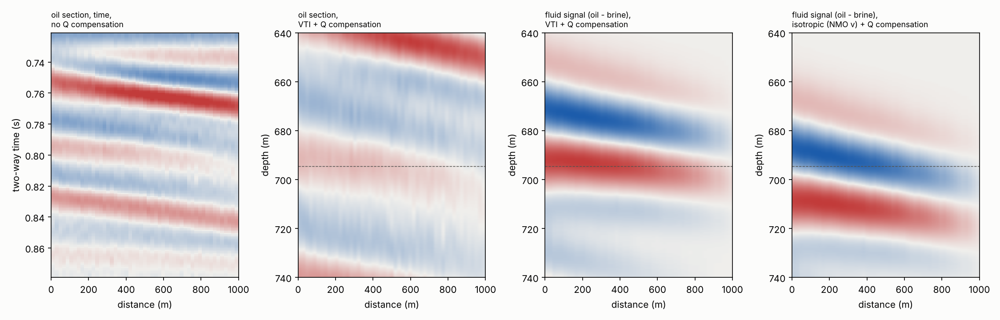

**What WP7 says about the article.**

1. **The time tie closes with the ZO-VSP alone,** once the blind interval above the logs is
   filled from it. Anisotropy matters for depth positioning, here by 17 m.
2. **The AVA cannot close without removing elastic contamination.** P-wave interbed multiples
   alone are small here; with mode conversion the contamination reaches 1–2 × Born beyond
   300 m. Elastic modelling and subtraction, or elastic inversion of the reservoir
   interval, would be needed; an acoustic demultiple would not suffice.
3. **A reservoir Vs change can stand in for an overburden Q error** (posterior correlation
   +0.59). A "rock-physics Vs" is justified only by independent evidence, such as
   dipole-dispersion analysis or a Vs from the walkaway shear arrivals, not by the AVA fit.
4. **The parts of the model must share one resolution.** A better calibration would fit the
   intrinsic γ → (ε, δ) relation so that the Backus average of the log model at the walkaway
   scale (40 m) reproduces the walkaway ε and δ. Anisotropy would then be zeroed in log-flagged
   stringers. The direct fit used here is the article's method.
5. **The shallowest Q** (seabed to the first VSP receiver) needs its own constraint: the
   source signature or the seabed multiples.

## WP8 results (synthetic well, through files; `iwt demo` and the commands above, about 10 s)

**The files reproduce the in-memory results.**

- **SEG-Y:** IBM samples round-trip to 2⁻²¹ relative precision (hexadecimal normalization), IEEE
  exactly. Elevations and depths keep centimetres through the scalar words. segyio reads these
  files, and this reader reads segyio's, with identical samples and headers.
- **LAS:** logs round-trip to the file's printed precision, both through a TVDSS curve and
  through MD minus the kelly bushing. us/m and kg/m³ (metric), us/ft and g/cm³ (imperial),
  depths in feet, null values and decreasing depths are all handled.

**`iwt vsp` on the demo VSP** (121 levels, 0.3 % noise). Intrinsic Q per block (true values in
brackets), with the stratigraphic t\* from the logs:

| driving the stratigraphic synthetic with | 450–600 m | 600–740 m | 740–800 m | 800–1650 m |
|---|---|---|---|---|
| the recorded first arrival (`iwt vsp`) | **45.5** (45.5) | **59.0** (58.8) | 120 (80) | **71.8** (70) |
| the true source, a 40 Hz Ricker (WP3, WP7) | 45.8 | 60.1 | 123 | 72.0 |
| a Ricker at the first arrivals' peak frequency (47 Hz) | 48.5 | 70.5 | 126 | 71.2 |

- **Drive the stratigraphic synthetic with the recorded first arrival.** The stratigraphic t\*
  depends on the spectrum that enters the layering. A Ricker fitted to the peak frequency (the
  ghost raises it from 40 to 47 Hz) biases the middle block by 20 %. The recorded downgoing
  arrival at the top receiver beats even the true source wavelet: it already carries the ghost
  and the attenuation above the array.
- **The 60 m Fruholmen block stays unresolved** (as in WP3).

**`iwt model`.** The gap velocity from the VSP is 2129 m/s (true 2067 m/s). The model's vertical
times differ from the VSP by −0.77 ms on average (0.83 ms RMS). Two effects are left:

- **The bias of the reference pick** (WP3);
- **the scale effect:** a 0.5 m layered model gives the ray-theory time, which is faster than
  the 30 Hz effective medium (Backus). The physical calibration of WP3 removes this with a 40 m
  Backus average. The model keeps the fine layers, because the synthetics need them.

**`iwt tie`.**

| trace | wavelet | correlation (best) | shift | phase |
|---|---|---|---|---|
| VSP corridor stack | 30 Hz Ricker (the deconvolution target) | 0.944 (0.980) | +0.7 ms | +3° |
| seismic trace (with Q) | 30 Hz Ricker, Q in the synthetic | 0.950 (0.990) | +1.5 ms | −4° |
| seismic trace (with Q) | 30 Hz Ricker, no Q in the synthetic | 0.909 (0.947) | +0.2 ms | +16° |
| seismic trace (with Q) | estimated over the window (in-sample) | 0.986 | −0.6 ms | −1° |

- **Leaving the overburden Q out of the synthetic** of a trace that is not Q-compensated costs
  0.04 in correlation. It also shows up as a 16° phase rotation, which the complex correlation
  separates from the time shift.
- **The estimated wavelet is fitted in the same window it is scored on,** so its correlation is
  optimistic. Use it to diagnose the phase of the data; the Ricker tie is the fair test.
  - The reflectivity is modelled only up to `--f-max` (100 Hz), where the wavelet has signal.
  - The wavelet's tails are tapered: the noise at 5 % otherwise shows as 0.1-amplitude jitter.

## Using real data

The adapters exist so that the synthetic set can be replaced by recorded data. **Whether the
Hanssen (7324/7-2) logs and VSPs are released has not been checked.** Released Norwegian well
data are ordered through the Diskos portal; see the plan, assumption 4.

1. **Logs (LAS 2.0).**
   - The P and S slownesses and the density are found by mnemonic (`DTCO`, `DTC`, `DT`, …;
     `DTSM`, `DTS`, …; `RHOB`, `RHOZ`, …), or named with `p_curve`, `s_curve` and
     `rho_curve` in `read_las`.
   - Depth comes from a TVDSS curve. Without one, it is MD minus the kelly-bushing elevation
     (`--kb`, or the EKB/KB/EREF/EDF/APD header item), which is right only for a vertical well.
     Deviated wells need a TVDSS curve: deviation surveys are not read.
   - Set the tool frequencies (`--f-sonic-p`, `--f-sonic-s`): LAS files do not record them, and
     the dispersion correction depends on them.
2. **ZO-VSP (SEG-Y).**
   - One trace per level, starting at the shot time. Use the vertical component, or the
     component along the direct arrival: 3C rotation is not implemented.
   - Receiver depth: by default the receiver group elevation (bytes 41–44, with the scalar in
     bytes 69–70), read as a negative elevation below sea level. Contractors differ, so check
     the textual header and set `--depth-field`, `--depth-sign` and `--depth-shift`.
   - Source depth comes from bytes 49–52 and the offset from bytes 37–40, or from the options.
   - Shot-to-shot source variation should be removed beforehand (near-field hydrophone); this
     is not implemented.
3. **Seismic trace (SEG-Y).** The trace at the well, in two-way time below sea level. The Ricker
   tie assumes zero-phase data; use `--wavelet estimate` to see the actual phase.
4. **Not covered by the command line:**
   - walkaway VSP picking and inversion, and CMP-gather migration. The library functions
     (`iwt.vsp.walkaway`, `iwt.imaging.migrate_cmp` with `read_gather`) take the data, but
     walkaway first breaks and polarizations must be picked elsewhere;
   - DLIS logs, deviated wells, 3D survey geometry, and SEG-Y with variable trace length or
     more than 65535 samples.

## The article's claims, tested on the synthetic well

| Claim (Lewis et al., 2016) | Where | Finding here | WP |
|---|---|---|---|
| The tie is "largely achieved in terms of event timing and AVO/AVA response" | Fig. 2 | **Reproduced in timing, not in AVO.** The corridor stack ties at correlation 0.93 after the ZO-VSP calibration, and most of the gain comes from filling the blind interval above the logs. Both AVA criteria fail (rows below). | 3, 7 |
| Sonic-to-seismic drift comes from dispersion and layering | text, Table 1 | **Reproduced.** The 11.9 ms drift drops to 0.1–0.3 ms RMS with the VSP intrinsic Q and a Backus average, without a fitted parameter. With the apparent Q the layering is counted twice. | 3 |
| The ZO-VSP gives the overburden Q | Table 1 | **Reproduced for the intrinsic Q** after the stratigraphic correction: within 2–4 % in thick blocks. The apparent Q is biased, a 60 m block is not resolved, and the interval above the first receiver is unconstrained. | 3, 7, 8 |
| Sonic γ, calibrated by the WA-VSP, gives ε and δ along the well | text, Table 1 | **Reproduced with caveats.** γ is within 0.014 per unit, if the mud slowness is right. The six-level calibration puts δ 0.035–0.04 too high in the shallow shales. The smoothed curve gives isotropic stringers shale anisotropy. | 4, 5, 7 |
| The WA-VSP measures ε and δ at 640–860 m | Leaney & Hornby (2007) | **Reproduced.** ε is within 0.01 of the 40 m Backus truth at five of six levels, δ within 0.03. The polarizations halve the ε error. | 5 |
| Anisotropic Q-PSDM ties best | Fig. 3 | **Ranking reproduced:** AVA misfit 0.014, against 0.16–0.24 for the isotropic images. Anisotropic PSDM without Q is much worse here (0.53) than the article's "OK". A Q 30 % too low overshoots the gradient by 58 %. | 6 |
| Interbed multiples from the overburden contaminate the reservoir AVO | Fig. 4 | **Reproduced as elastic contamination:** 0.9–1.5 × the single-scattering response, growing with angle. P-wave interbed multiples alone are small, so an acoustic demultiple would not repair it. | 7 |
| A field-wide rock-physics Vs in the reservoir matches the AVA better | Fig. 4 | **Not testable as a fact about Wisting, and shown to be risky.** The synthetic has no reservoir-Vs anomaly beyond dispersion. Correcting the dipole Vs for dispersion fits worse. A Vs fitted to the AVA (+3 %, the opposite sign) would absorb the overburden-Q error (posterior correlation +0.59). | 7 |
| Reprocessing reveals a flat oil–water contact | Fig. 5 | **Only partly testable in 1D.** Anisotropy positions the fluid signal (a 17 m difference), but Q compensation barely sharpens it at zero offset. | 7 |

**Critical assessment.** The plan's points (`docs/IMPLEMENTATION_PLAN.md`, section 6) stand. The
work packages sharpened them as follows:

1. **The loop needs explicit criteria.** With criteria fixed before tuning, the time tie passes
   and both AVA criteria fail. "Largely achieved" is accurate for the tie, not for the AVO. The
   discrepancy register (`docs/discrepancy_register.md`) makes the stopping rule auditable.
2. **The AVA cannot choose between the article's explanations.**
   - The identifiability study shows the reservoir AVA constrains density and the overburden Q,
     not the reservoir Vs or δ.
   - A reservoir Vs change is therefore an unsafe fix. It needs independent evidence, such as
     dipole-dispersion analysis or walkaway shear arrivals.
   - *Better:* a joint inversion of the VSP, the walkaway and the AVA, with explicit noise
     models.
3. **Every part of the model must have the same resolution.** The log velocities, the γ-based
   anisotropy and the walkaway calibration live at different scales. Mixing them changes the
   synthetic AVA by more than any single parameter does. *Better:* calibrate the intrinsic
   γ → (ε, δ) relation through the Backus average of the log model at the walkaway scale, and
   zero the anisotropy in stringers flagged by the logs.
4. **The shallowest Q is not measured.** Between the seabed and the first VSP receiver it is
   only assumed, and this alone leaves a 3 % amplitude error at a reservoir 250 m below the
   seabed. *Better:* the t\* of the direct arrival against a recorded source signature, or the
   seabed multiples.
5. **The contamination is elastic.** *Better:* elastic model-based subtraction or elastic
   inversion of the reservoir interval, then re-measure the AVO. Ideally this means elastic
   VTI FWI of the walkaway VSP jointly with the surface data (plan, point 10).
6. **There is no blind test.** *Better:* calibrate on one family of data and validate on
   another (plan, section 5), and test the calibrated model at a second well, such as Wisting
   Central 7324/8-1, if its data are released.

## Errata and ambiguities in the article

- "PGS, formally Schlumberger" should read "formerly".
- "worfklow" (Conclusions) and "that that" (Results) are typos.
- The abbreviations are inconsistent: "WAVSP" (Summary, Table 1) against "WA-VSP" (text).
- The depth reference of the walkaway levels "640 and 860 m" (MD or TVD, which datum) is not
  stated; this implementation assumes TVDSS (assumption 3).
- **Table 1 is not independent.** Qp's *calibration* source (the surface seismic) is also one of
  its *validation* sources (critical point 6).
- **The tool frequencies, mud properties and Q values behind the sonic-to-seismic correction are
  not reported.** The correction cannot be reproduced from the article alone; this
  implementation's values are assumptions (section "The synthetic well").

## Assumptions

1. **"LFP article" means Lewis et al. (2016)**, the only article in [`References/`](References/).
2. **The model is a synthetic stand-in.** All elastic and attenuation values, and all formation
   tops other than the seabed, top Stø, the OWC and TD, are assumed (section "The synthetic
   well"). They are not Wisting measurements.
3. **Depths are TVDSS, positive down.** RKB ≈ 40 m is *derived* from two TD values (1719 m TVD
   RKB and 1679 m below sea level). Top Stø TVDSS assumes a vertical well. The public facts were
   taken from web-search quotations, because omv.com and factpages.sodir.no were not reachable
   from the build environment. The article does not state the datum of its 640–860 m walkaway
   levels.
4. **Velocities in the model apply at 30 Hz** (`f_ref`). Dispersion follows Kjartansson's (1979)
   constant-Q law between 30 Hz and the tool frequencies (12 kHz and 2 kHz, assumed).
5. **Thomsen's δ is inverted with C13 + C44 ≥ 0**, the physically usual root.
6. **Backus averaging assumes the long-wavelength limit.** The running average uses a box window.
   A window shorter than about a third of the shortest wavelength is the usual choice; 10 m is
   about a third of the wavelength at 2300 m/s and 80 Hz.
7. **Gassmann assumes** an isotropic, connected pore space at low frequency. Applying it to the
   reservoir sand only is a simplification.
8. **Anisotropic attenuation uses one Q per wave type** (WP2). The P-wave Q acts on C33 and C11,
   and the S-wave Q on C44. This is the simplest choice; direction-dependent Q is not modelled.
9. **The source is an explosion in the sea and the medium is laterally homogeneous** (WP2).
   - Records are cylindrically symmetric.
   - Waves evanescent in the sea are omitted (take-off angles to 88°).
   - The direct wave in the sea is therefore approximate at near-grazing angles, and a receiver
     at the source point is singular.
   - The PP coefficients of the linearized formulas use the incidence angle in place of the
     mean of incidence and transmission angles.

10. **The ZO-VSP is modelled as a vertical-incidence plane wave** (WP3). It has no geometric
    spreading and no source offset; both are frequency independent and are absorbed by the
    intercepts of the Q fits. The point-source records of WP2 were also tried. Their
    slowness-integral truncation leaves a 2–3 % precursor 30–50 ms before the first arrival at the
    shallow receivers, inside the spectral window, and that biased t* in the top block. The
    straight-ray offset correction is tested separately.
11. **Noise is white, band-limited Gaussian at 0.3 % of each trace's peak** (about 50 dB). 1 % is
    reported as a sensitivity case.
12. **WP3 parameter choices:**
    - the t* band is 10–100 Hz;
    - the first-arrival window runs from 50 ms before to 100 ms after the pick;
    - the Q blocks are bounded by the Hekkingen, Fruholmen and Snadd tops;
    - the seismic frequency is 30 Hz;
    - the Backus window is 40 m (about half the 30 Hz wavelength). In a noise-free test, 20 m
      raised the residual with the VSP intrinsic Q from 0.18 to 0.30 ms RMS.
13. **The log-based stratigraphic model** fills the gap between the seabed and the top of the
    logs (417.5–470 m) with one layer of the mean of the first 10 m of logs. It is isotropic
    with no Q, which is enough at vertical incidence.
14. **The well is vertical,** so the anisotropy term of the physical calibration is zero. It is
    implemented with Thomsen's (1986) weak-anisotropy relation for deviated wells.
15. **WP4 tool and borehole parameters (assumed):**
    - the Stoneley slowness is measured at 500 Hz, a single-frequency phase slowness. Real
      array processing gives a spectrum-weighted average of the dispersion curve (Tang, 2003);
    - the tool is concentric and rigid, with a 46 mm radius;
    - the mud is 1540 m/s and 1250 kg/m³; processing assumes 1500 m/s and the correct
      density, from the mud weight;
    - the dipole reads the axial shear velocity at 2 kHz; flexural dispersion is assumed
      already removed.
16. **The Stoneley wave sees the Backus medium of the 1.8 m array aperture** (arithmetic C66).
    This is exact for layers much thinner than the borehole radius. For thicker layers the
    tube wave averages the compliance 1/C66 instead, which matters only next to the stringers.
17. **Qs = Qp / 2** moves the dipole C44 to the Stoneley frequency, because the VSP gives only
    the P-wave Q.
18. **No permeability or mudcake effect** on the Stoneley wave, and no eccentricity.
19. **The walkaway is modelled with exact qP ray theory in a 1D VTI model** (WP5), without
    waveforms: first-break times and polarizations with Gaussian errors (0.2 ms, 1.5°), picks
    independent between traces. Head waves are not modelled; rays steeper than 85° in any layer
    are dropped.
20. **The walkaway "truth" is the 40 m running Backus average**, the medium seen by a 40 m
    sub-array at about 50 Hz (λ ≈ 60–70 m). Ray theory in a model layered on the 10 m scale is a
    separate test case.
21. **One azimuth, vertical well, laterally homogeneous medium** unless stated. Azimuthal
    anisotropy is simulated by a different VTI model per azimuth; lateral heterogeneity by a
    source static linear in offset.
22. **Priors:** Vp0 from the ZO-VSP with 1 % error, Vs0 from the dipole log with 5 % error. The
    γ → (ε, δ) relation is a straight line with Gaussian priors N(0, 0.1²) on the intercept and
    N(0.5, 2²) on the slope.
23. **Imaging is 1D** (WP6): a CMP gather over a laterally homogeneous earth, migrated offset by
    offset with stationary-phase (true-amplitude) weights. This keeps the Fig. 3 experiment;
    2D/3D aperture, dip and migration noise are not modelled (plan, critical point 7).
24. **The Q operator is first order in 1/Q and isotropic.** One P-wave Q per layer acts along
    the whole ray. The reflectivity modelling also lets the shear Q act on oblique P waves.
    The difference is at most 2–3 % in amplitude at 35°.
25. **The "observed" data are noise-free Born primaries without free surface** (WP6): no ghosts,
    no multiples, no converted waves. The migration models are 20 m Backus averages of the true
    model. WP7 adds internal multiples and mode conversion and uses the estimated models (ZO-VSP
    Q, walkaway ε and δ).
26. **AVA conventions** (WP6): amplitudes are trough picks on the migrated gather, followed
    across offsets. The angle is that of the migration model at the picked depth. The fits use
    20–44°: the 3D data in the article start at 20°, and beyond 44° the seabed reflection
    approaches the reservoir.

27. **The WP7 surface "measurement" has no free surface and no noise** (deghosted and
    free-surface demultipled). Noise is added only to the ZO-VSP, the walkaway and the Fig. 5
    section. In 417.5 m of water the first seabed multiple arrives near 1.1 s, after the
    reservoir, but peg-legs from the shallow section would add to the contamination.
28. **Every estimated model uses Qs = Qp/2,** because the VSP gives only the P-wave Q. The model
    takes the Q of the first VSP block between the seabed and the first receiver (450 m).
29. **"Contamination-free" means the Born primaries:** an ideal demultiple that also removes
    the transmission and conversion losses. A real demultiple keeps those losses, so its
    output would also need amplitude balancing.
30. **The identifiability Jacobian is linearized** around 8 m unit means on either side of the
    Stø top, with the exact VTI interface coefficient. It ignores the tuning by the stringers.
    The overburden-Q column is −π f t\*(θ) per relative change of Q, with f = 35 Hz and t\*
    from the migration table. The prior standard deviations are assumed: Vs 3 %, ρ 2 %, ε and
    δ 0.03, and Q 30 %.
31. **The AVA acceptance criterion uses 20–44°, not the plan's 30–50°,** because the seabed
    reflection crosses the reservoir at about 54° (WP6). The criteria were fixed before any
    tuning and were not changed after the results.
32. **The Fig. 5 section is imaged column by column at zero offset** with the 20 m Backus
    averages of the true oil-section models. The isotropic variant uses the NMO velocity Vp0 √(1 + 2δ). The
    contact is scored by the fluid signal (oil image minus brine image, without the noise
    image), not by picking: a 2–22 m column at 30 Hz gives no separate contact event to pick.
33. **File conventions** (WP8):
    - depths are m TVDSS, positive down;
    - without a TVDSS curve, TVDSS = MD − KB (vertical well);
    - a VSP receiver depth is read by default as the negative of the receiver group elevation;
    - SEG-Y traces start at the delay recording time, in whole milliseconds;
    - seismic traces for the tie are in two-way time below sea level.
34. **The sonic tool frequencies are not in LAS files.** The defaults (12 kHz monopole, 2 kHz
    dipole) are assumptions, and the dispersion correction is only as good as these values.
35. **The command line assumes a zero-offset VSP with a stable source.** It uses one trace per
    level and straight-ray vertical times, and does not correct for shot-to-shot signature
    variation.

## Notes found while implementing

- **The plan defined interbed multiples as "full minus primaries-only" (WP7). That is misleading
  in finely layered media.** The primaries keep transmission losses that short-period multiples
  largely restore. WP2 therefore adds Born primaries (`transmission_loss=False`) as the reference,
  and the plan is corrected.
- **The Rüger (1997) approximation is accurate to about 30°** on this well, but not near the
  critical angle at top Fruholmen (WP2).
- **The WP2 ZO-VSP delay was misattributed** to Q. It is the waveform convention of
  `Reflectivity.record`, whose wavelet is the source potential (see the corrected WP2 section).
- **Naive peak picks jump between lobes** (WP3). This happens with a source ghost, where two
  lobes are nearly equal, or with upgoing waves interfering. The picker therefore chooses the lobe
  once and follows it along the onset moveout.
- **The Hilbert envelope must be zero-padded.** Energy still arriving at the end of the trace
  otherwise wraps to t = 0, and the onset guide jumps there.
- **Measure phase delays on the separated downgoing wavefield.** On raw traces, upgoing
  reflections in the window scatter the 30 Hz times by about 0.5 ms, and the reference trace is
  biased by 1 ms.
- **Interval Q needs an intercept.** The reference receiver sits at the edge of the array, where
  separation is one-sided, and its spectrum error (−0.2 ms of t*) otherwise lands entirely in the
  first block.
- **A velocity gradient inside a thick block biases the blocked interval velocities of its thin
  neighbours.** On this well, Snadd as one block moved Fruholmen by 600 m/s, so it is split into
  100 m blocks.
- **The plan's formula 1/Q_int = 1/Q_app − 1/Q_strat holds only for consistent measurements.**
  Q_app and Q_strat must use the same band and estimator. The second-order interaction (the
  multiples are themselves attenuated) is at or below 1 × 10⁻³ in 1/Q here.
- **The Stoneley wave is leaky in slow VTI shales** (WP4). The tube wave, set by C66, outruns
  the axial shear wave, set by C44, so the mode radiates; its slowness is complex. The
  isotropic substitute with shear modulus C66 misses this, and with it more than half of
  the dispersion at 500 Hz in the shallow shales.
- **Close to the leaky–trapped transition, the real Stoneley slowness does not determine C66
  uniquely.** One leaky and one trapped C66 can give the same slowness; the Stoneley attenuation
  would tell them apart. In tests with random formations this affected 1 sample in 2400, and
  about 4 % of the samples had no followable root at 500 Hz.
- **Gamma combines two tools with different frequencies and apertures.**
  - The dipole's higher frequency (2 kHz against 500 Hz, Qs ≈ 25) biases γ low by 0.01–0.03.
  - Its shorter aperture, next to stringers, creates spurious γ spikes.
  - Both are fixed by moving and averaging C44 to the Stoneley frequency and aperture before
    γ is formed.
- **The walkaway residual must not have a hard edge** (WP5). Fitting q(p) fails when a noisy p
  lies beyond the model's horizontal slowness: the model has no real q there, and the fit is
  pushed to the bounds. Fitting the phase velocity against the phase angle, V(θ), has no such
  edge.
- **Letting the effective-variance covariance vary inside the misfit biases towards strong
  anisotropy** (WP5): models that inflate the errors look better. It is held fixed at the current
  iterate instead.
- **A single missing pick must not void the whole p measurement** (WP5): the dense window
  operator propagated one NaN to every source. Missing picks now void only the windows that use
  them.
- **Mute strong shallow events before Q compensation** (WP6). The stabilized inverse filter
  rings near the high cut, and the direct wave and the seabed reflection, 3–100 times stronger
  than the target, leaked into the reservoir AVA as 4 % wiggles until they were muted.
- **The angle of a migration table belongs to the layer above each depth** (WP6). On a sharp
  interface, a pick 0.3 m below it reads the transmitted angle, and R(θ) checks then fail by
  15 %. Smooth migration models avoid this.
- **The seabed reflection limits the reservoir AVA to about 45°** (WP6). In 417 m of water the
  seabed reflection crosses the Stø reflection at about 1150 m of offset (54°). A shallow
  reservoir under deep water loses its far angles to it, not only to the acquisition.
- **The plan's WP1 check "Backus averaging of isotropic layers gives ε ≥ 0" was wrong.** The test
  suite found counter-examples, in about 10 % of random stacks. The correct statements are
  γ ≥ 0 and ε ≥ δ (η ≥ 0); ε can be negative when Vp contrasts are small and Vs contrasts large
  (Berryman et al., 1999). The plan and the tests now say so.
- **Ray-Born synthetics fail for thin fast stringers beyond about 27°** (WP7). A ray-Born
  gather in a smoothed background loses the cancellation between the tops and bases of thin
  beds once they go post-critical, and the reservoir AVA was wrong by tens of per cent. The
  predictions therefore use the full reflectivity method.
- **A real cross-correlation mistakes a phase rotation for a time shift.** For a band-limited
  wavelet a constant rotation φ looks like a shift of about φ/(2πf), about 3 ms per 30° at
  30 Hz. The tie metrics use the
  complex cross-correlation of the analytic signals: its envelope gives the shift and its
  phase the rotation.
- **The blind interval above the first log controls a shallow tie.** Filling the 52 m gap with
  log velocities made the synthetic 8 ms late (correlation −0.06). The VSP interval velocity
  fixed it (0.93).
- **The contamination cannot be split into "multiples" and "converted waves" by switching
  physics off** (WP7). Without mode conversion, P-wave multiples are small (0.11–0.34 × Born);
  with it, the converted primaries and the multiples are each larger than their sum and
  largely cancel. Switching mode conversion off is not a physical medium either: at far
  offsets the P-only response loses the converted energy and gets none of it back. The
  contamination is reported as full − Born, near and far.
- **Swapping the truth in one part at a time does not attribute the misfit when the parts have
  different resolutions** (synthetic only). The smoothed anisotropy curves give the stringers
  shale anisotropy; that error is harmless on smoothed velocities and severe on sharp ones.
- **The physical Vs correction and the AVA-fitted Vs have opposite signs** on this well. A Vs
  tuned to the AVA would have absorbed the overburden Q error.
- **The stratigraphic t\* depends on the wavelet driving the synthetic** (WP8). A Ricker at the
  recorded peak frequency biased the intrinsic Q of a block by 20 %. The recorded downgoing
  first arrival at the shallowest receiver gives the same reference spectrum as the data.
- **A wavelet estimated over the tie window inflates the tie** (WP8). It is fitted and scored
  on the same samples, so it diagnoses the phase but does not test the model.
- **A misplaced Q block boundary biases the neighbouring block** (WP8 tests; the Q analogue of the WP3 note on velocity blocks).
  Boundaries at 700 m instead of the true 650 m gave Q 92 instead of 80 below.

## Repository layout

```
iwt/
  paper.py        numbers in the article (page/table/figure) and public Hanssen facts (sourced)
  model.py        ElasticModel1D; Thomsen <-> Cij; stability; phase velocities; Backus; time-depth
  qmodel.py       constant-Q (Kjartansson) dispersion and attenuation
  rockphysics.py  Gassmann fluid substitution, Reuss fluid mixing
  synthetic.py    the Wisting-like true model, its wireline logs, caliper and Stoneley logs
  calibration.py  drift curve; knee and physical sonic calibration; gamma -> (eps, delta) calibration
  sonic.py        C33, C44, C66 and gamma; tube wave with tool; exact TI Stoneley mode; uncertainty
  raytrace.py     exact qP phase and group velocity, slowness, polarization; direct and reflected rays
  imaging.py      constant-Q operators, gain-limited inverse Q; Q-compensated CMP depth migration
  avo.py          event tracking on migrated gathers; intercept-gradient fits; linear resolution
  welltie.py      wavelet estimation, phase rotation, tie metrics (correlation, shift, phase, PEP)
  workflow.py     model from logs; model versions, discrepancy register, acceptance criteria
  multiples.py    gathers with physics switched off step by step; relative RMS
  io.py           SEG-Y (numpy, rev 1/2), LAS (lasio), CSV logs, models and time-depth tables
  cli.py          the `iwt` command: demo, vsp, model, tie (also `python -m iwt`)
  plotting.py     well, anisotropy, AVO, gather, depth-profile and trace displays (matplotlib)
  modeling/
    elastic.py       VTI plane waves with constant Q: slownesses, eigenvectors, interface scattering
    reflection.py    exact (isotropic, VTI) and approximate PP reflection coefficients
    convolution.py   wavelets, normal-incidence synthetics, angle gathers
    reflectivity.py  Kennett reflectivity method with physics switches; point-source records
  vsp/
    zovsp.py         picking, time-depth, interval velocity, separation, deconvolution, corridor stack
    attenuation.py   first-arrival spectra, spectral ratio, centroid shift, interval Q
    walkaway.py      synthetic walkaway, slowness-polarization measurement and inversion, checks
    processing.py    the ZO-VSP chain in one call (times, velocities, intrinsic Q, corridor stack)
examples/wp1_synthetic_well.py      prints the WP1 numbers and writes docs/figures/wp1_*.png
examples/wp2_forward_modelling.py   AVO, normal-incidence check, multiples, ZO-VSP; docs/figures/wp2_*.png
examples/wp3_zovsp.py               ZO-VSP processing, Q, drift calibration; docs/figures/wp3_*.png
examples/wp4_sonic_anisotropy.py    Stoneley dispersion, gamma processing ladder, uncertainty; wp4_*.png
examples/wp5_walkaway.py            walkaway eps and delta, checks, gamma calibration; wp5_*.png
examples/wp6_imaging.py             moveout, Q-compensated migration variants (Fig. 3), gain limit; wp6_*.png
examples/reproduce_paper.py         the integrated loop (WP7); register, Figs. 2, 4, 5 analogues; wp7_*.png
tests/            pytest suite (168 tests)
docs/             implementation plan, discrepancy register and figures
References/       the article (PDF)
```

Run the tests with `pytest`. The plotting tests are skipped when matplotlib is missing.

## References

* Aki, K., & Richards, P. G. (1980). *Quantitative Seismology: Theory and Methods*. W. H. Freeman.
* Alkhalifah, T., & Tsvankin, I. (1995). Velocity analysis for transversely isotropic media. *Geophysics*, 60(5), 1550–1566. https://doi.org/10.1190/1.1443888
* Backus, G. E. (1962). Long-wave elastic anisotropy produced by horizontal layering. *Journal of Geophysical Research*, 67(11), 4427–4440. https://doi.org/10.1029/JZ067i011p04427
* Banik, N. C., Lerche, I., & Shuey, R. T. (1985). Stratigraphic filtering, Part I: Derivation of the O'Doherty–Anstey formula. *Geophysics*, 50(12), 2768–2774. https://doi.org/10.1190/1.1441897
* Barry, K. M., Cavers, D. A., & Kneale, C. W. (1975). Recommended standards for digital tape formats. *Geophysics*, 40(2), 344–352. (SEG-Y revision 0)
* Berryman, J. G., Grechka, V., & Berge, P. A. (1999). Analysis of Thomsen parameters for finely layered VTI media. *Geophysical Prospecting*, 47(6), 959–978. https://doi.org/10.1046/j.1365-2478.1999.00163.x
* Biot, M. A. (1952). Propagation of elastic waves in a cylindrical bore containing a fluid. *Journal of Applied Physics*, 23(9), 997–1005. https://doi.org/10.1063/1.1702365
* Cavalca, M., Fletcher, R., & Riedel, M. (2013). Q-compensation in complex media—Ray-based and wavefield extrapolation approaches. *SEG Technical Program Expanded Abstracts 2013*, 3831–3835. https://doi.org/10.1190/segam2013-1130.1
* Canadian Well Logging Society. *LAS Version 2.0: A digital standard for logs* (1992; updated 2014). https://www.cwls.org
* Cheng, C. H., & Toksöz, M. N. (1981). Elastic wave propagation in a fluid-filled borehole and synthetic acoustic logs. *Geophysics*, 46(7), 1042–1053. https://doi.org/10.1190/1.1441242
* Fryer, G. J., & Frazer, L. N. (1984). Seismic waves in stratified anisotropic media. *Geophysical Journal International*, 78(3), 691–710. https://doi.org/10.1111/j.1365-246X.1984.tb05065.x
* Gaiser, J. E. (1990). Transversely isotropic phase velocity analysis from slowness estimates. *Journal of Geophysical Research*, 95(B7), 11241–11254. https://doi.org/10.1029/JB095iB07p11241
* Gassmann, F. (1951). Über die Elastizität poröser Medien. *Vierteljahrsschrift der Naturforschenden Gesellschaft in Zürich*, 96, 1–23.
* Goetz, J. F., Dupal, L., & Bowler, J. (1979). An investigation into discrepancies between sonic log and seismic check shot velocities. *APEA Journal*, 19(1), 131–141. https://doi.org/10.1071/AJ78014
* Grechka, V., & Mateeva, A. (2007). Inversion of P-wave VSP data for local anisotropy: Theory and case study. *Geophysics*, 72(4), D69–D79. https://doi.org/10.1190/1.2742970
* Grechka, V., Tsvankin, I., & Contreras, P. (2024). Inversion of walkaway VSP data in the presence of lateral velocity heterogeneity. *Energy Geoscience*, 5(2), 100255. https://doi.org/10.1016/j.engeos.2023.100255
* Hagelund, R., & Levin, S. A. (Eds.) (2017). *SEG-Y_r2.0: SEG-Y revision 2.0 Data Exchange format*. SEG Technical Standards Committee.
* Hardage, B. A. (1985). *Vertical Seismic Profiling, Part A: Principles* (2nd ed.). Geophysical Press.
* Hauge, P. S. (1981). Measurements of attenuation from vertical seismic profiles. *Geophysics*, 46(11), 1548–1558. https://doi.org/10.1190/1.1441161
* Hinds, R. C., Anderson, N. L., & Kuzmiski, R. D. (1996). *VSP Interpretive Processing: Theory and Practice*. SEG. https://doi.org/10.1190/1.9781560801894
* Kennett, B. L. N., & Kerry, N. J. (1979). Seismic waves in a stratified half space. *Geophysical Journal International*, 57(3), 557–583. https://doi.org/10.1111/j.1365-246X.1979.tb06779.x
* Kjartansson, E. (1979). Constant Q-wave propagation and attenuation. *Journal of Geophysical Research*, 84(B9), 4737–4748. https://doi.org/10.1029/JB084iB09p04737
* Kommedal, J. H., & Tjøstheim, B. A. (1989). A study of different methods of wavefield separation for application to VSP data. *Geophysical Prospecting*, 37(2), 117–142. https://doi.org/10.1111/j.1365-2478.1989.tb01826.x
* Leaney, W. S., & Hornby, B. E. (2007). Depth-dependent anisotropy from sub-salt walkaway VSP data. *69th EAGE Conference & Exhibition*. https://doi.org/10.3997/2214-4609.201401677
* Lewis, O. J., et al. (2016). Integrated processing of borehole and surface seismic measurements for enhanced well tie and AVO analysis. *78th EAGE Conference & Exhibition*. https://doi.org/10.3997/2214-4609.201601553
* Lizarralde, D., & Swift, S. (1999). Smooth inversion of VSP traveltime data. *Geophysics*, 64(3), 659–661. https://doi.org/10.1190/1.1444574
* Marion, D., Mukerji, T., & Mavko, G. (1994). Scale effects on velocity dispersion: From ray to effective medium theories in stratified media. *Geophysics*, 59(10), 1613–1619. https://doi.org/10.1190/1.1443550
* Mavko, G., Mukerji, T., & Dvorkin, J. (2009). *The Rock Physics Handbook* (2nd ed.). Cambridge University Press. https://doi.org/10.1017/CBO9780511626753
* Miller, D. E., & Spencer, C. (1994). An exact inversion for anisotropic moduli from phase slowness data. *Journal of Geophysical Research*, 99(B11), 21651–21657. https://doi.org/10.1029/94JB01848
* Molyneux, J. B., & Schmitt, D. R. (1999). First-break timing: Arrival onset times by direct correlation. *Geophysics*, 64(5), 1492–1501. https://doi.org/10.1190/1.1444653
* Norris, A. N. (1990). The speed of a tube wave. *Journal of the Acoustical Society of America*, 87(1), 414–417. https://doi.org/10.1121/1.399262
* Norris, A. N., & Sinha, B. K. (1993). Weak elastic anisotropy and the tube wave. *Geophysics*, 58(8), 1091–1098. https://doi.org/10.1190/1.1443493
* Norris, M. W., & Faichney, A. K. (Eds.) (2002). *SEG Y rev 1 Data Exchange format*. SEG Technical Standards Committee.
* O'Doherty, R. F., & Anstey, N. A. (1971). Reflections on amplitudes. *Geophysical Prospecting*, 19(3), 430–458. https://doi.org/10.1111/j.1365-2478.1971.tb00610.x
* Quan, Y., & Harris, J. M. (1997). Seismic attenuation tomography using the frequency shift method. *Geophysics*, 62(3), 895–905. https://doi.org/10.1190/1.1444197
* Richards, P. G., & Menke, W. (1983). The apparent attenuation of a scattering medium. *Bulletin of the Seismological Society of America*, 73(4), 1005–1021. https://doi.org/10.1785/BSSA0730041005
* Rio, P., Mukerji, T., Mavko, G., & Marion, D. (1996). Velocity dispersion and upscaling in a laboratory-simulated VSP. *Geophysics*, 61(2), 584–593. https://doi.org/10.1190/1.1443984
* Rüger, A. (1997). P-wave reflection coefficients for transversely isotropic models with vertical and horizontal axis of symmetry. *Geophysics*, 62(3), 713–722. https://doi.org/10.1190/1.1444181
* Seeman, B., & Horowicz, L. (1983). Vertical seismic profiling: Separation of upgoing and downgoing acoustic waves in a stratified medium. *Geophysics*, 48(5), 555–568. https://doi.org/10.1190/1.1441486
* Shuey, R. T. (1985). A simplification of the Zoeppritz equations. *Geophysics*, 50(4), 609–614. https://doi.org/10.1190/1.1441936
* Stewart, R. R., Huddleston, P. D., & Kan, T. K. (1984). Seismic versus sonic velocities: A vertical seismic profiling study. *Geophysics*, 49(8), 1153–1168. https://doi.org/10.1190/1.1441745
* Tang, X. M. (2003). Determining formation shear-wave transverse isotropy from borehole Stoneley-wave measurements. *Geophysics*, 68(1), 118–126. https://doi.org/10.1190/1.1543199
* Thomsen, L. (1986). Weak elastic anisotropy. *Geophysics*, 51(10), 1954–1966. https://doi.org/10.1190/1.1442051
* Tsvankin, I. (2012). *Seismic Signatures and Analysis of Reflection Data in Anisotropic Media* (3rd ed.). SEG. https://doi.org/10.1190/1.9781560803003
* Valero, H.-P., Djikpesse, H. A., & Sinha, B. K. (2009). Estimation of borehole fluid slowness using sonic array waveforms. *SEG Technical Program Expanded Abstracts 2009*, 361–365. https://doi.org/10.1190/1.3255617
* Walden, A. T., & White, R. E. (1998). Seismic wavelet estimation: A frequency domain solution to a geophysical noisy input-output problem. *IEEE Transactions on Geoscience and Remote Sensing*, 36(1), 287–297. https://doi.org/10.1109/36.655337
* Walsh, J., Sinha, B., Plona, T., & Ammerman, M. (2007). Derivation of anisotropy parameters in a shale using borehole sonic data. *SEG Technical Program Expanded Abstracts 2007*, 323–327. https://doi.org/10.1190/1.2792435
* Wang, Y. (2002). A stable and efficient approach of inverse Q filtering. *Geophysics*, 67(2), 657–663. https://doi.org/10.1190/1.1468627
* White, J. E. (1983). *Underground Sound: Application of Seismic Waves*. Elsevier.
* White, J. E., & Tongtaow, C. (1981). Cylindrical waves in transversely isotropic media. *Journal of the Acoustical Society of America*, 70(4), 1147–1155. https://doi.org/10.1121/1.386946
* White, R. E., & Simm, R. (2003). Tutorial: Good practice in well ties. *First Break*, 21(10). https://doi.org/10.3997/1365-2397.21.10.25640
* Winkler, K. W., Liu, H.-L., & Johnson, D. L. (1989). Permeability and borehole Stoneley waves: Comparison between experiment and theory. *Geophysics*, 54(1), 66–75. https://doi.org/10.1190/1.1442578
* OMV (2014). OMV finds hydrocarbons at Hanssen well in Norway (press release). https://www.omv.com/en/media/press-releases/2014/omv-finds-hydrocarbons-at-hanssen-well-in-norway
* Sokkeldirektoratet. Wellbore 7324/7-2 factpage. https://factpages.sodir.no/en/wellbore/pageview/exploration/all/7450

DOIs were checked against the Scite index; the WP3 and WP4 references were also checked against publisher records (the White & Simm page range could not be confirmed and is omitted). The exact tool-term notation of Norris (1990) could not be checked against its full text; the form used here was derived from the annulus compliance. The WP5 references Grechka & Mateeva (2007) and Grechka et al. (2024) were checked against the Scite index; Gaiser (1990), Miller & Spencer (1994) and Tsvankin (2012) by their DOIs. The WP6 references (Alkhalifah & Tsvankin, 1995; Wang, 2002; Cavalca et al., 2013) and the WP7 references (Walden & White, 1998; White & Simm, 2003; O'Doherty & Anstey, 1971; Kjartansson, 1979) are those of the plan, checked there by DOI. The WP8 format standards were checked by web search (the Scite quota was spent): the Barry et al. (1975) citation is confirmed, but its DOI was not, so none is given; the SEG-Y revision 1 (May 2002) and 2.0 (2017) editors and dates were confirmed from copies of the documents and the SEG release; the LAS 2.0 history (1992 release, CWLS) was confirmed from the USGS and the UK National Archives format registries. The SEG-Y byte positions used in `iwt.io` were checked against segyio's field tables, and the test suite checks the reader and writer against segyio in both directions.
